# Architecture and Technical Documentation: Quill

Quill is an enterprise-grade academic operations and document intelligence platform. It unifies high-throughput document processing (OCR, chunking, dense vector embeddings, hybrid RAG), automated curriculum operations (timetable extraction, conflict detection, room/faculty allocation, invigilation scheduling), and assessment workflows (Bloom's taxonomy question paper generation, rubric-driven AI grading of handwritten student scripts, faculty review overrides, class analytics, and multi-tenant portals for staff, students, and parents).

---

## 1. Overview

### 1.1 Purpose and Problem Statement
Educational institutions manage fragmented software ecosystems: one tool for timetabling spreadsheets, another for learning management, third-party question generators, manual paper grading, and separate portals for parents and students. 

Quill unifies these workflows around a single **document intelligence engine**. When faculty upload a syllabus, timetable, or student answer script (PDF, image, or text), Quill processes it through an asynchronous, multi-stage background pipeline. Once ingested, documents can be:
1. Queried with grounded page-level citations using hybrid retrieval.
2. Extracted into structured relational entities (timetables, room allocations, courses, faculty).
3. Synthesized into comprehensive multi-section question papers with solutions, rubrics, and LaTeX math.
4. Paired with rubrics to evaluate student submissions via computer vision and language model analysis.

### 1.2 Target Audiences and Roles
Quill enforces Role-Based Access Control (RBAC) across five discrete personas:
- **`ADMIN`**: Full administrative visibility across the tenant workspace; manages master data (faculty, rooms, courses, timetables, invigilation duties), creates workspaces, inspects system telemetry, and retries failed jobs.
- **`EDUCATOR`**: Faculty and teaching staff who upload course documents, generate examination papers, review and override AI-graded submissions, manage extra classes, and view their daily teaching agenda ("Today View").
- **`ANALYST`**: Academic auditors who inspect campus-wide document ingestion health, pipeline latency metrics, query analytics, and class grade distributions without modifying campus operational records.
- **`STUDENT`**: Enrolled students who authenticate to inspect assigned coursework, view due dates, upload answer scripts for evaluation, and view feedback once reviewed.
- **`PARENT`**: Guardians linked to specific student roster records via `ParentLink`, granting read-only access to published assessment scores and academic feedback.

### 1.3 Key Features
- **Asynchronous Ingest Pipeline**: Multi-stage job processing (`convert` &rarr; `ocr` &rarr; `chunk` &rarr; `embed`) orchestrated via BullMQ and Redis with per-stage execution metrics, exponential backoff, and WebSocket updates.
- **Dual Storage Architecture**: Cloudflare R2 (S3-compatible object storage) for production-grade file persistence with automated fallback to the local filesystem for offline development.
- **Pre-Storage Virus Scanning**: Integrated ClamAV daemon and binary scanner checking all incoming multipart uploads before disk persistence or S3 dispatch.
- **Hybrid RAG Engine**: Reciprocal Rank Fusion (RRF) combining Pinecone serverless dense vector search (768-dimensional Matryoshka-truncated embeddings) with PostgreSQL lexical `ILIKE` pattern matching, followed by hosted inference reranking and token-streamed Server-Sent Events (SSE).
- **Automated Timetable Solving & Conflict Engine**: Multimodal timetable extraction from scanned schedules, heuristic clash detection (faculty overlaps, room double-bookings, consecutive period overloads), and a greedy schedule synthesizer.
- **Paper Studio & Multi-Format Exporters**: Generation of multi-tier question papers with Bloom's taxonomy tags, complete answer keys, and dynamic export to PDF (via headless Chromium Playwright and KaTeX), Word DOCX (via `docx`), LaTeX, and Markdown.
- **Rubric-Driven Assessment Engine**: Automated evaluation of student answer sheets against structured rubrics, storing distinct AI-generated and teacher-overridden scores with detailed criteria commentary.
- **Audit Logging**: Batched asynchronous audit trail recording all security, authentication, and mutation actions with IP address, correlation ID, and JSON metadata.
- **Deterministic Offline Demo Mode**: Zero-dependency offline simulation of all generative, embedding, and grading capabilities when `GEMINI_API_KEY` is omitted, guaranteeing reproducible execution across CI/CD and air-gapped environments.

### 1.4 Technology Stack
| Layer | Technologies & Libraries | Version / Details |
|---|---|---|
| **Backend Runtime** | Bun | &ge; 1.2 / 1.3 (Native TypeScript execution, Argon2id hashing) |
| **HTTP Framework** | Hono | `^4.12.23` (Edge-compatible router, middleware pipeline) |
| **Realtime WebSockets** | Socket.IO, `@socket.io/bun-engine` | `^4.8.3` / `^0.1.1` (Document-room multiplexing) |
| **Database & ORM** | PostgreSQL 16, Prisma ORM | Prisma `~6.19.3` (`@prisma/client`, migrations, connection pooling) |
| **Vector Database** | Pinecone Serverless | `@pinecone-database/pinecone` `^8.2.0` (768-dim cosine metric) |
| **Job Queue & Cache** | BullMQ, Redis 7 (Alpine), `ioredis` | BullMQ `^5.78.0`, ioredis `^5.11.0` |
| **AI Models** | Google Gemini (`@google/genai`) | `^2.8.0` (`gemini-3.5-flash`, `gemini-embedding-001`) |
| **Document Processing** | Poppler (`pdftoppm`), Tesseract.js | Tesseract.js `^7.0.0` (Serialized worker OCR) |
| **Document Export** | Playwright, KaTeX, Marked, docx | Playwright `^1.60.0`, KaTeX `^0.17.0`, docx `^9.7.1` |
| **Object Storage** | Cloudflare R2 / AWS S3 SDK | `@aws-sdk/client-s3`, `@aws-sdk/lib-storage` `^3.1111.0` |
| **Malware Defense** | NodeClam (`clamscan`) | `^2.4.0` (ClamAV daemon/socket integration) |
| **Security & Auth** | `jose`, Zod | `jose` `^6.2.3` (HS256 JWT in httpOnly cookie), Zod `^4.4.3` |
| **Frontend Framework**| Next.js 16 (App Router), React 19 | Next.js `16.3.1`, React `19.2.8` |
| **UI Components** | Tailwind CSS v4, Base UI, Lucide | Tailwind `^4.3.3`, `@base-ui/react` `^1.7.0`, `lucide-react` `^1.31.0` |
| **Client State & Cache**| TanStack React Query, Sonner | `@tanstack/react-query` `^5.101.4`, `sonner` `^2.0.8` |

---

## 2. System Context Diagram

The following diagram illustrates Quill within its operating context, highlighting interactions between external actors, core application boundaries, underlying storage systems, and cloud AI infrastructure.

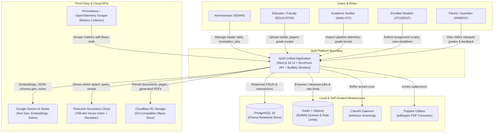

### Contextual Walkthrough
The Quill unified platform sits at the center of institutional operations. Users authenticate via browser clients and issue requests across dedicated role surfaces. The backend coordinates local infrastructure—PostgreSQL for relational integrity, Redis for task distribution, ClamAV for malware prevention, and Poppler for Linux-native document rendering. For cognitive operations, Quill connects securely to external managed platforms: Google Gemini for generative inference, Pinecone for vector indexing and neural reranking, and Cloudflare R2 for resilient object storage. External monitoring services collect system telemetry through an authenticated `/metrics` Prometheus scraper.

---

## 3. High-Level Architecture Diagram

The diagram below details the internal tiered structure of Quill, illustrating the separation of concerns across the presentation tier, API gateway, job queues, distributed worker pool, and persistence mechanisms.

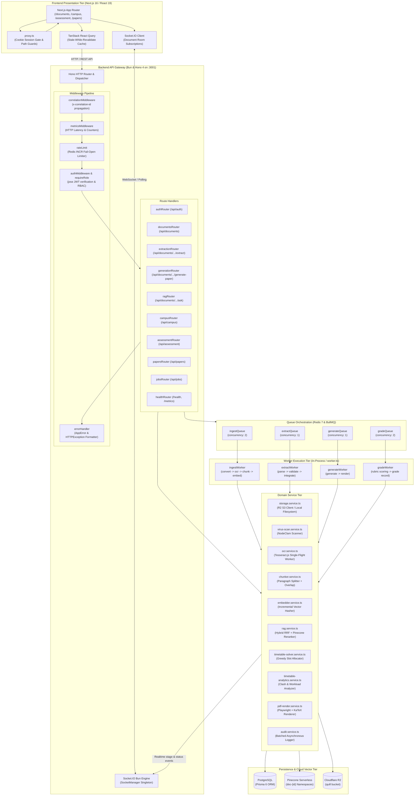

### Architectural Walkthrough
Client requests originate from the Next.js frontend, where `proxy.ts` performs optimistic cookie checks to eliminate client-side route flashing. REST requests target Hono on port 3001, flowing through a strict middleware sequence: correlation ID injection, latency recording, Redis-backed rate limiting, and JWT authentication. Heavy computational tasks (document ingestion, timetable extraction, paper rendering, and script grading) bypass the request-response thread entirely: route handlers write `Job` records to PostgreSQL, enqueue messages in BullMQ, and immediately return HTTP `202 Accepted` to the client.

Workers consume jobs from Redis with explicit concurrency bounds. Each worker transitions the job through discrete named stages (`Job.stages`), recording stage-level durations for operational telemetry. Workers emit events through `SocketManager` to broadcast real-time state mutations over WebSockets to client rooms scoped to specific document IDs. Persistent state is segregated: structured entities reside in PostgreSQL via Prisma, dense mathematical embeddings in Pinecone serverless namespaces, and raw binary assets (source documents, extracted page images, generated question paper PDFs) in Cloudflare R2.

---

## 4. Component / Module Dependency Diagram

The following diagram tracks the internal module import topology across the backend codebase, mapping dependencies between entry points, routes, middleware, domain services, infrastructure configurations, and utility modules.

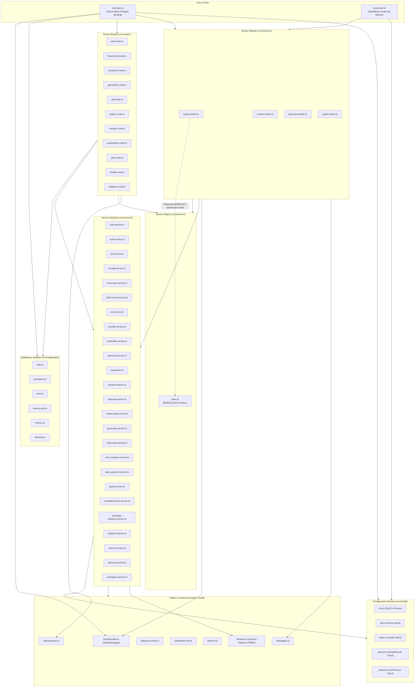

### Dependency Analysis & Coupling Review
1. **Clean Layering**: Route handlers depend strictly on services, validators, and queues. They do not access background workers directly.
2. **Circular Dependency Flag (Ingest to Grade Queue)**: `ingest.worker.ts` imports `enqueueGrade` from `src/queues/index.ts`. When an ingested document is detected as an assignment submission (`prisma.submission.findFirst({ where: { documentId } })`), it automatically triggers the downstream grading worker. While logical, queue producers normally reside in route handlers or dedicated orchestrator services rather than within peer workers.
3. **Database Client Centralization**: All database access flows through `prisma` instantiated as a singleton in `src/config/db.ts`, preventing Prisma client connection exhaustion.
4. **Redis Client Sharing**: Both BullMQ queue instances (`src/queues/index.ts`) and rate limiting middleware (`src/middleware/rate-limit.ts`) share the singleton `Redis` connection in `src/config/redis.ts`, configured with `maxRetriesPerRequest: null`.

---

## 5. Repository Structure

Below is an annotated directory tree of the monorepo, detailing the purpose of every folder and configuration file:

```
quill/
├── docker-compose.yml              # Local container infra: PostgreSQL 16 (pgvector) + Redis 7 Alpine
├── dev.sh                          # Orchestration script: launches compose, waits for Redis, runs API & UI
├── package.json                    # Root monorepo script runner (concurrently)
├── README.md                       # High-level architecture, quickstart, and demo credentials
├── LICENSE                         # MIT License documentation
│
├── docs/                           # Architectural roadmaps and scope audits
│   ├── ISSUES_AND_SCOPE.md         # Production gap audit, security reviews, and Wave 1-3 tracking
│   └── PRODUCT_ROADMAP.md          # Multi-quarter product roadmap and feature matrix
│
├── backend/                        # Backend API, background workers, and Prisma ORM
│   ├── Dockerfile                  # Container definition: Alpine Bun runtime, Poppler, Playwright Chromium
│   ├── package.json                # Backend dependencies and execution scripts
│   ├── tsconfig.json               # Backend TypeScript configuration
│   ├── eng.traineddata             # Tesseract English OCR neural model data asset
│   │
│   ├── prisma/                     # Database schema definitions and seed routines
│   │   ├── schema.prisma           # 21 PostgreSQL relational models, enums, composite unique constraints
│   │   └── seed.ts                 # Idempotent database seeder for demo workspace, users, and campus data
│   │
│   ├── scripts/                    # Developer utility and sample generation scripts
│   │   ├── sample-pdf.ts           # Playwright script generating a 2-page syllabus PDF test fixture
│   │   └── samples/                # Generated sample PDFs and mock timetables
│   │
│   ├── src/                        # Core backend TypeScript source code
│   │   ├── index.ts                # Server entry point: Hono app, Socket.IO engine, graceful shutdown
│   │   ├── worker.ts               # Standalone worker daemon entry point for isolated horizontal scaling
│   │   ├── types.ts                # Hono ContextVariableMap type augmentations (user, correlationId)
│   │   │
│   │   ├── config/                 # Infrastructure and client singletons
│   │   │   ├── db.ts               # PrismaClient database connection
│   │   │   ├── env.ts              # Zod environment variable parsing, validation, and typing
│   │   │   ├── gemini.ts           # Google Gen AI SDK initialization and Matryoshka embed wrapper
│   │   │   ├── pinecone.ts         # Pinecone client, schema definitions, and index initializer
│   │   │   └── redis.ts            # ioredis connection configured for BullMQ compatibility
│   │   │
│   │   ├── middleware/             # HTTP interception and validation middleware
│   │   │   ├── auth.ts             # JWT extraction from cookies/headers and role validation guards
│   │   │   ├── correlation.ts      # UUID generation and x-correlation-id propagation
│   │   │   ├── error.ts            # Global error boundary converting AppError & HTTPException to JSON
│   │   │   ├── metrics-auth.ts     # HTTP Basic Auth gate guarding /metrics in production environments
│   │   │   ├── metrics.ts          # Request latency timers and Prometheus metric counters
│   │   │   └── rate-limit.ts       # Redis-backed fail-open sliding rate limiter
│   │   │
│   │   ├── prompts/                # Versioned AI system instructions
│   │   │   └── index.ts            # Prompts for timetable extraction, RAG answering, papers, and grading
│   │   │
│   │   ├── queues/                 # BullMQ queue registry
│   │   │   └── index.ts            # Queue definitions and enqueue helpers for ingest, extract, generate, grade
│   │   │
│   │   ├── routes/                 # Hono API route handlers
│   │   │   ├── analytics.route.ts  # Workspace summary, pipeline stage latencies, 30-day activity
│   │   │   ├── assessment.route.ts # Student roster, assignment CRUD, submissions, grading overrides
│   │   │   ├── auth.route.ts       # Login, logout, session verification (/me), password change, workspaces
│   │   │   ├── campus.route.ts     # Today view, master data (faculty/rooms/courses), timetable solver
│   │   │   ├── documents.route.ts  # Multipart upload, document catalog, deletion, reingestion
│   │   │   ├── extraction.route.ts # Trigger extraction jobs, list extractions, timetable clash analytics
│   │   │   ├── generation.route.ts # Trigger question paper generation jobs, list papers
│   │   │   ├── health.route.ts     # /health/live, /health/ready, /metrics Prometheus exposition
│   │   │   ├── jobs.route.ts       # Job catalog exploration and failed job retry dispatcher
│   │   │   ├── papers.route.ts     # Paper Studio updates, single question regen, multi-format export
│   │   │   └── rag.route.ts        # Grounded document Q&A and SSE streaming token endpoints
│   │   │
│   │   ├── services/               # Core business logic and external integrations
│   │   │   ├── analytics.service.ts          # Aggregate system metrics and latency calculations
│   │   │   ├── audit.service.ts              # Batched, asynchronous audit logging buffer and flusher
│   │   │   ├── auth.service.ts               # Password verification, JWT signing/verifying, demo seed
│   │   │   ├── chunker.service.ts            # Paragraph-aware chunking with token budgets and page tracking
│   │   │   ├── demo-ai.service.ts            # Deterministic offline mock AI engine for demo mode
│   │   │   ├── docx-exporter.service.ts      # Word document generator with styles, tables, and rubrics
│   │   │   ├── embedder.service.ts           # Incremental vector embedding with SHA-256 chunk hashing
│   │   │   ├── extractor.service.ts          # Multimodal schema extraction coordinator
│   │   │   ├── generator.service.ts          # Paper generation coordinator and persistence
│   │   │   ├── grade.service.ts              # Automated submission scoring against rubrics
│   │   │   ├── integrate.service.ts          # Normalization of extracted timetable JSON into DB rows
│   │   │   ├── job.service.ts                # Stage-level lifecycle management for BullMQ jobs
│   │   │   ├── latex-exporter.service.ts     # Compilable LaTeX paper generator with escape filters
│   │   │   ├── master-data.service.ts        # Relational foreign-key resolver for course/faculty/room
│   │   │   ├── metrics.service.ts            # Prometheus text format serialization and in-memory gauges
│   │   │   ├── ocr.service.ts                # Serialized Tesseract.js worker pool with self-healing retry
│   │   │   ├── pdf-convert.service.ts        # Poppler pdftoppm wrapper converting PDF to PNG pages
│   │   │   ├── pdf-render.service.ts         # Playwright Chromium HTML-to-PDF renderer with inlined KaTeX
│   │   │   ├── pinecone.service.ts           # Pinecone vector upsert, deletion, query, and rerank client
│   │   │   ├── rag.service.ts                # RRF hybrid retrieval, context assembly, and SSE streaming
│   │   │   ├── storage.service.ts            # S3/R2 client with multipart upload and local fallback
│   │   │   ├── timetable-analytics.service.ts# Clash detection, room utilization, and workload calculator
│   │   │   ├── timetable-solver.service.ts   # Greedy slot placement and invigilation allocator
│   │   │   ├── virus-scan.service.ts         # ClamAV file and buffer scanner
│   │   │   └── workspace.service.ts          # Default workspace initializer and tenant backfiller
│   │   │
│   │   ├── socket/                 # Realtime communication
│   │   │   └── socket.ts           # SocketManager singleton multiplexing events to document rooms
│   │   │
│   │   ├── utils/                  # Reusable utility functions
│   │   │   ├── csv.ts              # CSV cell escaping and streaming header helpers
│   │   │   ├── gemini-call.ts      # Gemini JSON generator with corrective re-prompting validation loop
│   │   │   ├── json-extract.ts     # Robust JSON extractor handling code fences and unclosed braces
│   │   │   ├── logger.ts           # Structured JSON logger with timestamp, level, and correlationId
│   │   │   └── response.ts         # Standardized JSON response envelope helpers (ok, error)
│   │   │
│   │   ├── validators/             # Zod input validation schemas
│   │   │   ├── assessment.validator.ts       # Rubric, assignment, student roster, and grade schemas
│   │   │   ├── auth.validator.ts             # Login, password change, and workspace schemas
│   │   │   ├── campus.validator.ts           # Faculty, room, course, extra class, and timetable schemas
│   │   │   ├── extraction.validator.ts       # Timetable and generic extraction output schemas
│   │   │   └── paper.validator.ts            # Paper configuration, section, and update schemas
│   │   │
│   │   └── workers/                # BullMQ job consumers
│   │       ├── extract.worker.ts   # Extraction worker (parse -> validate -> integrate)
│   │       ├── generate.worker.ts  # Question paper generator worker (generate -> render)
│   │       ├── grade.worker.ts     # Assessment evaluation worker (scoring -> persistence)
│   │       └── ingest.worker.ts    # Document ingestion worker (convert -> ocr -> chunk -> embed)
│   │
│   └── tests/                      # Unit and integration test suites (Bun Test Runner)
│       ├── chunker.test.ts         # Tests for chunkText, token budgets, and page marker preservation
│       ├── demo.test.ts            # Tests for deterministic feature hashing and offline algorithms
│       ├── exporters-and-analytics.test.ts # Tests for DOCX, LaTeX, clash analyzer, and paper studio
│       ├── integrate.test.ts       # Tests for day normalization and slot collision deduplication
│       ├── json-extract.test.ts    # Tests for resilient JSON extraction from markdown/prose
│       └── validators.test.ts      # Comprehensive Zod schema validation test coverage
│
└── frontend/                       # Next.js 16 Web Application
    ├── package.json                # Frontend dependencies and build scripts
    ├── next.config.ts              # Next.js configuration (API rewrites, Turbopack, proxyClientMaxBodySize)
    ├── proxy.ts                    # Edge session guard redirecting unauthenticated traffic to /login
    ├── tsconfig.json               # Frontend TypeScript configuration
    ├── postcss.config.mjs          # PostCSS configuration for Tailwind CSS v4
    │
    ├── app/                        # Next.js App Router route hierarchy
    │   ├── layout.tsx              # Root HTML layout with Geist font, AppFrame shell, and Dark Theme
    │   ├── page.tsx                # Index redirect forwarding users to /documents
    │   ├── globals.css             # Tailwind v4 utility imports, design tokens, and CSS keyframe animations
    │   ├── login/                  # Authentication page and demo credentials switcher
    │   ├── documents/              # Document library, upload zone, and document detail view
    │   │   └── [id]/               # Nested document sub-routes: /ask, /extract, /paper
    │   ├── campus/                 # Campus management: /today, /timetable, /faculty, /rooms, /courses
    │   ├── assessment/             # Assessment hub: /assignments, /grading, /students, /analytics
    │   ├── papers/                 # Paper studio view and multi-format download center
    │   ├── student/                # Student portal: /student/assignments for script submissions
    │   ├── parent/                 # Parent portal: /parent/grades for performance tracking
    │   ├── jobs/                   # Internal pipeline diagnostic DAG and retry control view
    │   └── analytics/              # Academic operations KPIs and latency metrics dashboard
    │
    ├── components/                 # Reusable React components
    │   ├── app-shell.tsx           # Collapsible sidebar layout, navigation groups, user profile menu
    │   ├── ask-panel.tsx           # Document Q&A panel with citation chips and source drawers
    │   ├── assignment-detail.tsx   # Assignment rubric viewer and student submission list
    │   ├── confirm-delete.tsx      # Modal confirmation dialog for destructive mutations
    │   ├── contextual-ask.tsx      # Contextual RAG drawer embedded across campus and assessment pages
    │   ├── document-actions.tsx    # Document dropdown actions (re-ingest, extract, create paper, delete)
    │   ├── document-card.tsx       # Grid card representing an uploaded document with status indicator
    │   ├── document-chrome.tsx     # Breadcrumb and action header for single document views
    │   ├── document-overview-live.tsx # Real-time OCR text and chunk viewer with Socket.IO updates
    │   ├── document-progress.tsx   # Progress bar visualizing multi-stage pipeline state
    │   ├── document-subnav.tsx     # Tabbed navigation between Overview, Ask, Timetable, and Paper
    │   ├── dropzone.tsx            # Drag-and-drop file uploader with size validation
    │   ├── extract-panel.tsx       # Timetable and generic entity extraction trigger and display
    │   ├── faculty-link-banner.tsx # Warning banner prompting unlinked educators to connect to a faculty row
    │   ├── form-select.tsx         # Accessible select component wrapper
    │   ├── generate-panel.tsx      # Examination paper configuration builder form
    │   ├── grade-override.tsx      # Side-by-side rubric scoring editor for faculty grade overrides
    │   ├── kpi-card.tsx            # Metric display card for analytics dashboards
    │   ├── markdown.tsx            # Markdown renderer with syntax highlighting and KaTeX math
    │   ├── page-header.tsx         # Standardized page title, description, and action button container
    │   ├── paper-studio.tsx        # Interactive paper editor with per-question regeneration and exports
    │   ├── pipeline-dag.tsx        # Visual DAG of background pipeline stages with failure retry buttons
    │   ├── quill-mascot.tsx        # Vector SVG mascot with emotional state expressions
    │   ├── status.tsx              # Status badges and spinners for document and job states
    │   ├── timetable-analytics-view.tsx # Conflict warnings, room utilization charts, and workload matrix
    │   ├── timetable-grid.tsx      # Interactive 5x8 schedule grid with period conflict styling
    │   └── ui/                     # Primitives (Radix / Base UI styled with Tailwind)
    │
    ├── hooks/                      # Custom React hooks
    │   └── use-mobile.ts           # Media query hook for responsive mobile sidebar behavior
    │
    └── lib/                        # Client libraries and shared utilities
        ├── api.ts                  # Typed browser API client with fetch wrappers and error classes
        ├── server-api.ts           # Next.js Server Component API client forwarding incoming cookies
        ├── roles.ts                # Route permission predicates and landing page resolvers
        ├── socket.ts               # React hooks (useDocSocket, useJobsSocket) for Socket.IO subscriptions
        ├── types.ts                # TypeScript interfaces matching Prisma models and API envelopes
        └── utils.ts                # CSS class merging helper (clsx + tailwind-merge)
```

### 5.1 Skipped Files and Assets

In accordance with architectural review standards, the following non-logic, generated, or vendored assets were omitted from exhaustive line-by-line documentation:
1. **Package Lockfiles**: `pnpm-lock.yaml`, `bun.lockb` (reproducible dependency trees managed by package managers).
2. **Build Artifacts & Generated Code**: `frontend/.next/`, `backend/dist/`, and auto-generated Prisma Client typings in `backend/node_modules/@prisma/client` (produced by `bunx prisma generate`).
3. **Dependencies & Modules**: All third-party library files in `backend/node_modules/` and `frontend/node_modules/`.
4. **Binary & Model Weights**: `backend/eng.traineddata` (15 MB binary neural network model weights for Tesseract OCR).
5. **Static Assets & Fixtures**: Sample test fixture files in `backend/scripts/samples/` (`sample-syllabus.pdf`, `timetable.pdf`, `test-answers.pdf`) and static browser favicons/logos in `frontend/public/`.
6. **Vendored UI Primitives**: Standard uncustomized Base UI / Radix primitive wrappers located in `frontend/components/ui/` (`button.tsx`, `dialog.tsx`, `dropdown-menu.tsx`, `tooltip.tsx`, `tabs.tsx`, `slider.tsx`, `badge.tsx`, `input.tsx`, `label.tsx`).

---

## 6. Core Flows

This section details the primary end-to-end execution flows through the codebase.

### 6.1 Authentication and Session Verification
When a user signs in, credentials are submitted to `/api/auth/login`. The server verifies password hashes with Argon2id, generates an HS256 JWT containing workspace metadata, and writes an `httpOnly` cookie.

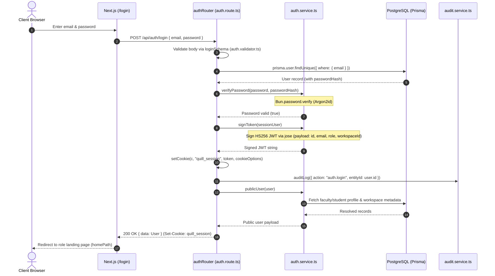

1. **Step 1-2**: Browser submits credentials to `POST /api/auth/login` via `api.login()`.
2. **Step 3**: The request body is validated against `loginSchema` in [`auth.validator.ts`](file:///home/salillakra/quill/backend/src/validators/auth.validator.ts#L3-L6).
3. **Step 4-5**: `authRouter` queries PostgreSQL for the user by lowercased email.
4. **Step 6-8**: `verifyPassword()` in [`auth.service.ts`](file:///home/salillakra/quill/backend/src/services/auth.service.ts#L12-L14) invokes `Bun.password.verify()` using Argon2id.
5. **Step 9-11**: `signToken()` constructs a `SignJWT` instance from `jose`, claims the subject ID, injects user role and workspace ID, and signs it using `env.JWT_SECRET`.
6. **Step 12-14**: An `httpOnly`, `sameSite: strict` session cookie named `quill_session` is attached to the Hono response context, and an asynchronous audit log entry is scheduled.
7. **Step 15-18**: User details, linked profile IDs (faculty or student), and workspace metadata are compiled via `publicUser()` and returned to the client.

---

### 6.2 Document Ingestion and Vector Indexing
When a user uploads a document, it undergoes pre-storage virus analysis, object storage persistence, and asynchronous processing across four pipeline stages: PDF-to-image conversion, OCR extraction, text chunking, and incremental vector embedding.

```mermaid
sequenceDiagram
    autonumber
    actor User as Client Browser
    participant DocRoute as documents.route.ts
    participant VirusSvc as virus-scan.service.ts
    participant StoreSvc as storage.service.ts
    participant Queue as ingestQueue (queues/index.ts)
    participant Worker as ingestWorker (ingest.worker.ts)
    participant Poppler as pdf-convert.service.ts
    participant OCR as ocr.service.ts
    participant Chunker as chunker.service.ts
    participant Embedder as embedder.service.ts
    participant Pinecone as pinecone.service.ts
    participant Socket as SocketManager

    User->>DocRoute: POST /api/documents (multipart/form-data)
    DocRoute->>DocRoute: Validate MIME & size <= 25MB
    DocRoute->>VirusSvc: scanBufferDirect(fileBuffer)
    VirusSvc-->>DocRoute: Scan clean (safe: true)
    DocRoute->>StoreSvc: saveUpload(docId, filename, fileBuffer)
    StoreSvc-->>DocRoute: Persisted objectKey (Cloudflare R2 / Local)
    DocRoute->>DocRoute: prisma.document.create({ status: "UPLOADED" })
    DocRoute->>DocRoute: createJob("INGEST", docId)
    DocRoute->>Queue: enqueueIngest(docId, jobId)
    DocRoute-->>User: 201 Created { document, job }

    Queue->>Worker: Process job (docId, jobId)
    Worker->>Socket: emitToDoc("doc:status", "PROCESSING")
    
    %% Stage: Convert
    Worker->>Worker: startStage(jobId, "convert")
    Worker->>Poppler: pdfToImages(inputPath, pagesDir)
    Poppler-->>Worker: { pageCount, imagePaths }
    Worker->>StoreSvc: uploadDocumentPages(docId, pagesDir)
    Worker->>Worker: completeStage(jobId, "convert")
    Worker->>Socket: emitToDoc("job:stage", { stage: "convert", status: "done" })

    %% Stage: OCR
    Worker->>Worker: startStage(jobId, "ocr")
    Worker->>OCR: ocrPages(imagePaths)
    Note over OCR: Serialized Tesseract.js worker with [Page N] tags
    OCR-->>Worker: Formatted ocrText string
    Worker->>Worker: prisma.document.update({ ocrText })
    Worker->>Worker: completeStage(jobId, "ocr")
    Worker->>Socket: emitToDoc("job:stage", { stage: "ocr", status: "done" })

    %% Stage: Chunk
    Worker->>Worker: startStage(jobId, "chunk")
    Worker->>Chunker: chunkText(ocrText, { maxChars: 4000, overlapChars: 200 })
    Chunker-->>Worker: Array of Chunk { index, content, page, tokenCount }
    Worker->>Worker: completeStage(jobId, "chunk")

    %% Stage: Embed
    Worker->>Worker: startStage(jobId, "embed")
    Worker->>Embedder: embedChunks(docId, chunks)
    Note over Embedder: Compute SHA-256 contentHash; skip unchanged vectors
    Embedder->>Pinecone: upsertDocumentVectors(docId, toUpsert)
    Pinecone-->>Embedder: Upsert confirmed
    Embedder-->>Worker: Embeddings synchronized
    Worker->>Worker: completeStage(jobId, "embed")

    Worker->>Worker: prisma.document.update({ status: "READY" })
    Worker->>Worker: succeedJob(jobId)
    Worker->>Socket: emitToDoc("job:done", { jobId, type: "INGEST" })
```

1. **Upload & Antivirus**: `POST /api/documents` intercepts the multipart file stream. [`virus-scan.service.ts`](file:///home/salillakra/quill/backend/src/services/virus-scan.service.ts#L105-L110) writes the buffer to an isolated temporary file and triggers a ClamAV scan. If clean, [`storage.service.ts`](file:///home/salillakra/quill/backend/src/services/storage.service.ts#L225-L229) streams the buffer to Cloudflare R2 (or local disk).
2. **Job Initialization**: An `INGEST` job is recorded in PostgreSQL with four pending stages (`convert`, `ocr`, `chunk`, `embed`) and enqueued in Redis via BullMQ.
3. **Conversion**: `ingest.worker.ts` invokes Poppler's native binary `pdftoppm -png -r 150` via [`pdf-convert.service.ts`](file:///home/salillakra/quill/backend/src/services/pdf-convert.service.ts#L13-L39) to render high-resolution PNGs for each page.
4. **OCR**: [`ocr.service.ts`](file:///home/salillakra/quill/backend/src/services/ocr.service.ts#L65-L72) processes page images sequentially through a single-flight Tesseract worker queue, prepending `[Page N]` headers to preserve page provenance.
5. **Paragraph-Aware Chunking**: [`chunker.service.ts`](file:///home/salillakra/quill/backend/src/services/chunker.service.ts#L23-L85) parses text along double-line paragraph breaks. It calculates running token budgets (~4000 characters / ~1000 tokens), strips page markers into metadata attributes, and carries a 200-character overlap tail across chunk boundaries cut at clean word breaks.
6. **Incremental Embedding**: [`embedder.service.ts`](file:///home/salillakra/quill/backend/src/services/embedder.service.ts#L25-L102) hashes each chunk's content via SHA-256. If a chunk already exists with an identical hash, vector re-computation is skipped. New or modified chunks are embedded via Gemini (`gemini-embedding-001` Matryoshka-truncated to 768 dimensions) or feature hashing in demo mode, and batch-upserted into Pinecone namespace `doc-{docId}`.

---

### 6.3 Grounded RAG Querying and Streaming
When a user asks a question about a document, Quill executes a hybrid retrieval search, combines candidates using Reciprocal Rank Fusion, applies hosted inference reranking, and streams grounded answers back over Server-Sent Events.

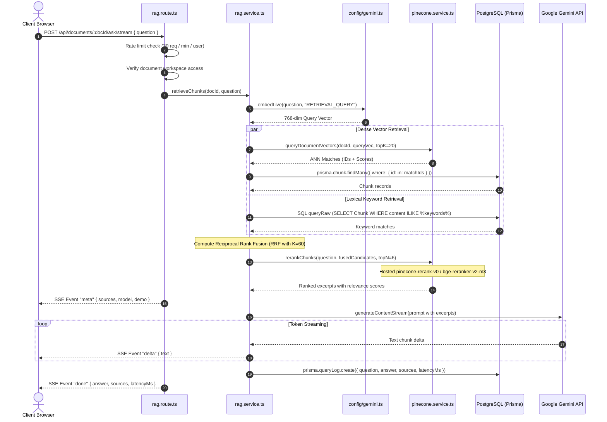

1. **Step 1-3**: Client initiates a POST request to `/api/documents/:docId/ask/stream`. The rate limiter verifies the user has not exceeded 30 queries per minute, and document access is confirmed.
2. **Step 4-5**: The query string is converted to a 768-dimensional dense vector using Gemini `gemini-embedding-001` (with `taskType: "RETRIEVAL_QUERY"`).
3. **Step 6-8**: **Dense Search**: Pinecone queries the document namespace (`doc-{docId}`) using cosine similarity, returning the top 20 candidate vector IDs. Database records are fetched to retrieve chunk text.
4. **Step 9-10**: **Lexical Search**: In parallel, PostgreSQL executes a parameterized `ILIKE` query across `Chunk.content` matching prominent query terms.
5. **Step 11**: **Reciprocal Rank Fusion (RRF)**: Candidate scores are merged using the standard formula:
   $$\text{Score}_{\text{RRF}} = \sum \frac{1}{60 + \text{Rank}}$$
6. **Step 12-13**: **Hosted Neural Rerank**: The top 20 fused candidates are dispatched to Pinecone's inference API using `pinecone-rerank-v0` (falling back to `bge-reranker-v2-m3`) to produce the top 6 most relevant excerpts.
7. **Step 14-17**: The server emits an SSE `meta` event containing source page citations, prompts Gemini with strict instructions to answer using *only* provided excerpts, streams `delta` token events, persists the conversation to `QueryLog`, and concludes with a `done` event.

---

### 6.4 Timetable Extraction and Campus Integration
When an educator extracts a timetable, the system passes OCR text and the page image to Gemini with a corrective validation loop, then normalizes periods and resolves relational foreign keys into database entities.

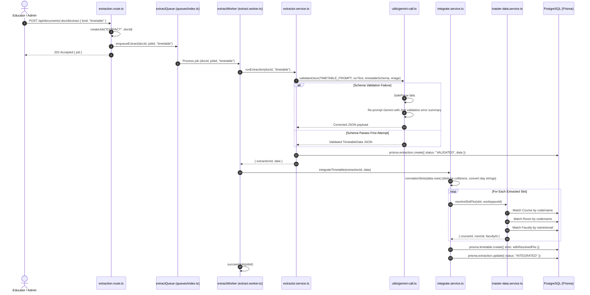

1. **Step 1-4**: The educator triggers extraction. A job with stages `parse`, `validate`, and `integrate` is enqueued in BullMQ.
2. **Step 5-9**: [`extractor.service.ts`](file:///home/salillakra/quill/backend/src/services/extractor.service.ts#L47-L107) prepares the prompt and retrieves the first page image. It calls [`validatedJson()`](file:///home/salillakra/quill/backend/src/utils/gemini-call.ts#L50-L66). If the LLM produces malformed JSON or omits required fields, the utility captures the `ZodError` issues and issues a second corrective prompt to Gemini containing the specific parsing errors.
3. **Step 10-12**: The validated structure is saved to `Extraction`. The worker then invokes [`integrateTimetable()`](file:///home/salillakra/quill/backend/src/services/integrate.service.ts#L39-L68).
4. **Step 13-17**: [`normalizeSlots()`](file:///home/salillakra/quill/backend/src/services/integrate.service.ts#L17-L34) converts day strings (`"Monday"`) into zero-indexed integers (`0`), discarding duplicate `(day, period)` slot clashes. [`resolveSlotFks()`](file:///home/salillakra/quill/backend/src/services/master-data.service.ts#L3-L40) conducts case-insensitive lookups against existing `Course`, `Room`, and `Faculty` rows within the workspace, binding relational foreign keys to the created `TimetableSlot` rows.

---

### 6.5 Question Paper Generation and Rendering
Faculty configure parameters for an examination (question types, difficulty profile, total marks, Bloom's cognitive target). Quill synthesizes questions, solutions, and rubrics, and then renders an official publication-ready PDF.

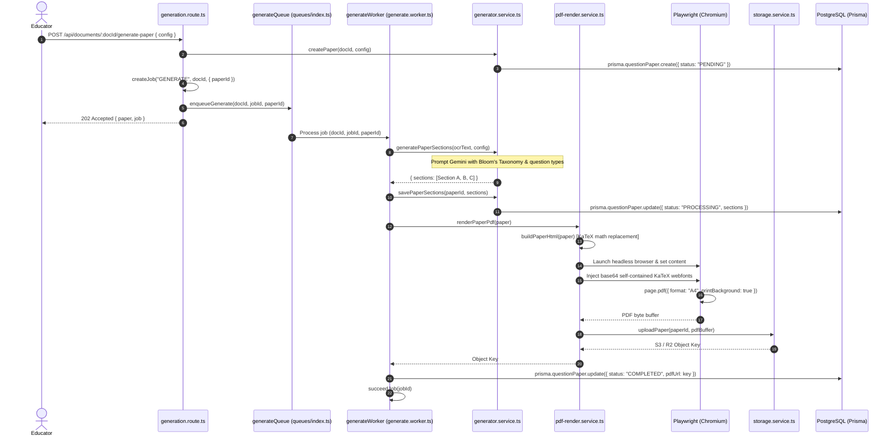

1. **Step 1-6**: Faculty submits an examination specification. A `QuestionPaper` record is created in `PENDING` status, and a BullMQ job with stages `generate` and `render` is dispatched.
2. **Step 7-10**: [`generator.service.ts`](file:///home/salillakra/quill/backend/src/services/generator.service.ts#L9-L22) calls Gemini with `buildPaperSystemPrompt(config)`. The model categorizes questions into logical sections (Objective/Conceptual, Short Analytical, Long Comprehensive), tagging each with its target Bloom's cognitive level (`REMEMBER` to `CREATE`), point-wise rubrics, and detailed step-by-step solutions.
3. **Step 11-16**: [`pdf-render.service.ts`](file:///home/salillakra/quill/backend/src/services/pdf-render.service.ts#L119-L142) constructs an HTML document, rendering inline LaTeX mathematical notation (`$...$`) via server-side KaTeX. It injects a base64-inlined KaTeX stylesheet to ensure self-contained, offline-compatible font rendering, launches headless Chromium via Playwright, generates an A4 PDF, and uploads the binary to Cloudflare R2 under `papers/{paperId}.pdf`.

---

### 6.6 Student Submission, Automated Grading, and Faculty Review
Students submit digital scripts for an assignment. Once the script is ingested and OCR'd, a grading worker automatically evaluates the student's text against assignment rubric criteria. Faculty inspect the AI-assigned scores, enter adjustments if necessary, and release the grade.

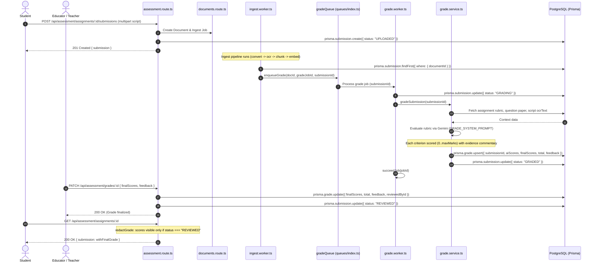

1. **Step 1-4**: The student submits an answer script via `POST /api/assessment/assignments/:id/submissions`. The route validates the student's linked account, scans the uploaded file for viruses, persists it, creates a `Document` record, and links it to a new `Submission` record in `UPLOADED` status.
2. **Step 5-7**: Ingest completes. In [`ingest.worker.ts`](file:///home/salillakra/quill/backend/src/workers/ingest.worker.ts#L163-L168), the worker checks if the document is linked to a submission and immediately enqueues a `GRADE` task into `gradeQueue`.
3. **Step 8-14**: `grade.worker.ts` invokes [`gradeSubmission()`](file:///home/salillakra/quill/backend/src/services/grade.service.ts#L11-L60). It fetches the assignment rubric and the OCR text of the student's handwritten or typed script. Gemini evaluates the response against each criterion independently, outputting strict JSON scores and feedback. Both `aiScores` and `finalScores` are initialized to these values in the `Grade` table, and the submission status advances to `GRADED`.
4. **Step 15-17**: Faculty inspect the submission in the Grading Queue. When they submit adjustments via `PATCH /api/assessment/grades/:id`, the server calculates the sum, timestamps the review, records `reviewedById`, and sets status to `REVIEWED`.
5. **Step 18-19**: `redactGrade()` in [`assessment.route.ts`](file:///home/salillakra/quill/backend/src/routes/assessment.route.ts#L28-L31) guarantees that non-staff roles (`STUDENT`, `PARENT`) receive `grade: null` until the teacher explicitly finalizes the review (`status === "REVIEWED"`).

---

## 7. Data Layer

### 7.1 Entity-Relationship Diagram
The following diagram defines the 21 relational models managed by Prisma in PostgreSQL, including data types, keys, and foreign-key constraints.

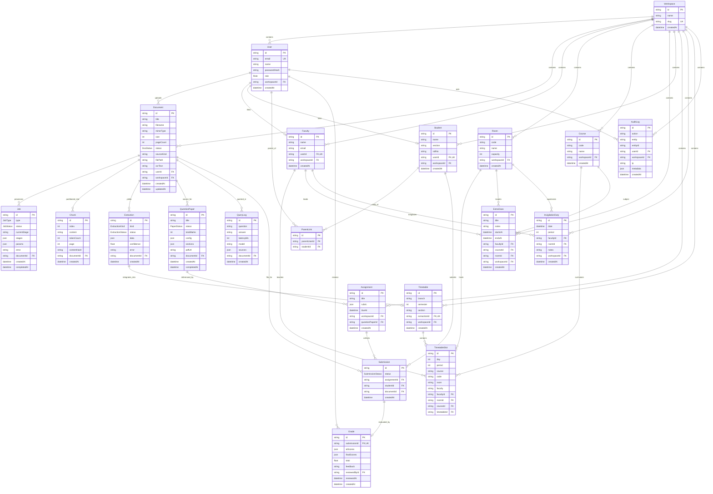

### 7.2 Database Model Descriptions and Indexes
- **`Workspace`**: Multi-tenant container. Enforces slug uniqueness (`@unique`). Cascade deletes or `SetNull` clean up child resources.
- **`User`**: Account records with Argon2id hashed credentials. `role` enum controls access. Foreign key `workspaceId` isolates tenancy.
- **`Document`**: Represents uploaded files. Stores extracted `ocrText` and file metadata. Scoped to `userId` and `workspaceId`.
- **`Job`**: Diagnostic tracking for asynchronous operations. `stages` stores a JSON array of `Stage` objects recording individual phase status and `durationMs`.
- **`Chunk`**: Segmented passages derived from `Document`. Indexed by `@@unique([documentId, index])`. `contentHash` stores SHA-256 for incremental vector updates.
- **`Faculty`, `Room`, `Course`**: Campus master entities. Enforce composite tenancy uniqueness:
  - `Faculty`: `@@unique([workspaceId, email])`
  - `Room`: `@@unique([workspaceId, code])`
  - `Course`: `@@unique([workspaceId, code])`
- **`Timetable` and `TimetableSlot`**: Relational representation of weekly schedules. Enforces `@@unique([timetableId, day, period])` to prevent schedule collisions.
- **`Student` & `ParentLink`**: Roster entities. Students enforce `@@unique([workspaceId, section, rollNo])`. `ParentLink` enforces `@@unique([parentUserId, studentId])`.
- **`Assignment`, `Submission`, `Grade`**: Assessment pipeline. A submission links an assignment, student, and uploaded document. `Grade.submissionId` is unique.
- **`AuditLog`**: Compliance trail indexed by `action`, `userId`, `workspaceId`, and `createdAt`.

### 7.3 Data Flow Diagram
The following flowchart traces how raw inputs transition into derived analytical and vector data structures.

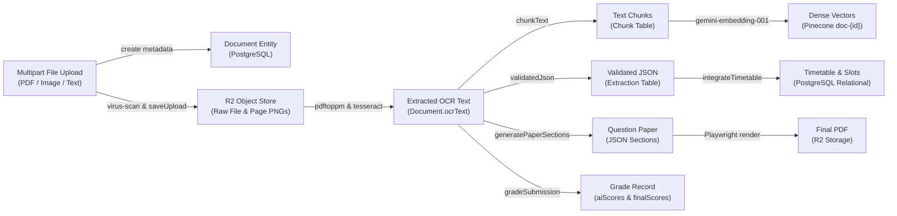

This data flow diagram illustrates how raw inputs (uploaded PDF documents, extracted text, and user prompt specifications) are progressively transformed into structured downstream artifacts. The ingest pipeline moves raw bytes through ClamAV antivirus scanning into S3/R2 storage, OCR rasterization, paragraph chunking, and 768-dimensional Pinecone vector upserts. Specialized downstream workers consume the clean OCR text to execute structured extraction into relational records, compile assessment blueprints into Playwright-rendered printable PDFs, and compute rubric-aligned grades for student answer scripts.

---

## 8. Class / Type Diagram

The diagram below maps the principal domain interfaces and error types that govern data flow across the backend and frontend boundaries.

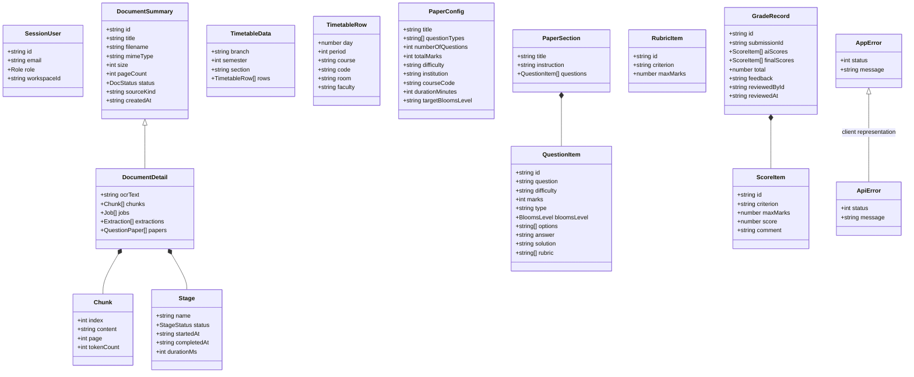

The class diagram models the structural taxonomy of Quill's core domain types and data contracts across frontend and backend boundaries. `DocumentDetail` extends `DocumentSummary` with chunk collections and pipeline processing stage telemetry, maintaining a composition hierarchy with `Chunk` and `Stage` records. Assessment structures model exam specifications (`PaperSection`, `QuestionItem`) and rubric evaluation items (`GradeRecord`, `ScoreItem`), while a unified error hierarchy (`AppError` and `ApiError`) standardizes operational failure propagation across all API endpoints.

---

## 9. State Machines

Entities undergoing lifecycle state transitions in Quill follow well-defined state machines.

### 9.1 Document Status Lifecycle (`DocStatus`)
A document begins in `UPLOADED` upon multipart ingest. It moves to `PROCESSING` when picked up by `ingestWorker`, reaching `READY` on successful vector upsert, or `FAILED` if conversion/OCR fails.

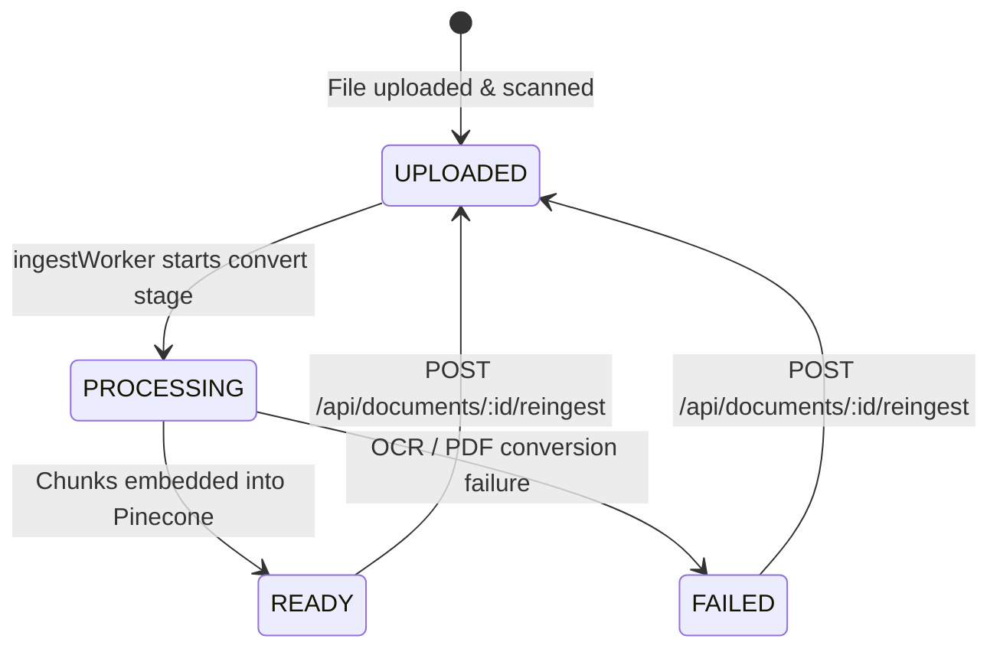

The document state machine enforces strict data integrity by ensuring documents cannot be queried via RAG before optical character recognition and Pinecone vectorization finish successfully. Worker failures during PDF page rendering or OCR extraction immediately mark the document as `FAILED` while capturing error diagnostics in the database. Instructors or system administrators can re-trigger processing via `POST /api/documents/:id/reingest`, safely resetting the document back to `UPLOADED` for reprocessing.

### 9.2 Background Job Lifecycle (`JobStatus`)
Jobs transition from `QUEUED` to `RUNNING` during execution. Uncaught worker exceptions mark the job as `FAILED`. Administrators can retry failed jobs, returning them to `QUEUED`.

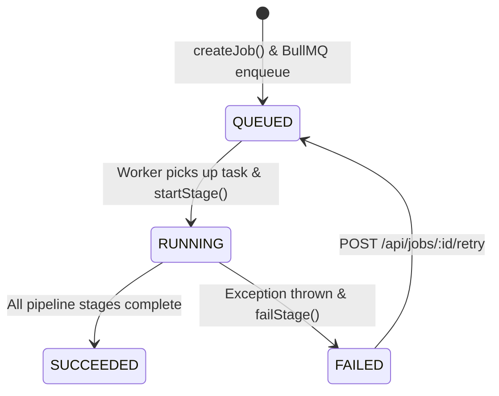

This lifecycle tracks asynchronous BullMQ background jobs across all four application queues. As workers pick up jobs from Redis, atomic database transactions record start times and milestone progress across individual pipeline stages. Any uncaught exceptions during execution gracefully mark the job as `FAILED` alongside structured error details, enabling administrators to retry the failed task without losing historical stage telemetry.

### 9.3 Assignment Submission Lifecycle (`SubmissionStatus`)
Student submissions begin in `UPLOADED`, enter `GRADING` while the AI evaluates the text against the rubric, advance to `GRADED` once scores are computed, and settle in `REVIEWED` when faculty confirm or override the marks.

```mermaid
stateDiagram-v2
    [*] --> UPLOADED : Student script uploaded
    UPLOADED --> GRADING : Document ingested; gradeWorker starts
    GRADING --> GRADED : AI rubric scores computed (Grade record created)
    GRADING --> UPLOADED : AI evaluation fails (retry allowed)
    GRADED --> REVIEWED : Faculty applies PATCH /api/assessment/grades/:id
    REVIEWED --> REVIEWED : Subsequent faculty grade modifications
```

The submission state machine governs the grading pipeline from student submission upload to final marks publication. Submissions transition into `GRADING` once the ingested script text is forwarded to the automated rubric evaluation engine. When AI evaluation completes, the submission reaches `GRADED` with preliminary itemized marks, after which instructors review and override individual scores, finalizing the workflow in `REVIEWED`.

---

## 10. Module-by-Module Code Explanation

### 10.1 Backend Entry Points & Configuration

#### `backend/src/index.ts`
- **Purpose**: Initializes the Hono HTTP router, binds Socket.IO over Bun's engine, registers middleware and routes, boots background workers, and coordinates graceful shutdowns.
- **Key Logic**:
  - `main()`: Connects Prisma, initializes demo workspaces (`ensureDemoWorkspace()`), ensures the Pinecone index exists, and starts all four BullMQ workers in-process.
  - `shutdown()`: Closes BullMQ workers with a 30s timeout, closes Socket.IO, disconnects Prisma, and flushes Redis.
  - `export default`: Exposes Bun's native server interface routing `/socket.io` to Engine.IO and all other paths to Hono.
- **Depends on**: Hono, `@socket.io/bun-engine`, Prisma, Redis, Pinecone, BullMQ workers.

#### `backend/src/worker.ts`
- **Purpose**: Standalone entry point to run BullMQ workers in a dedicated process or container for independent horizontal scaling.
- **Key Logic**: Connects to the database and vector index, boots workers, and keeps the event loop alive via `setInterval`.
- **Depends on**: `src/workers/*`, `src/config/*`.

#### `backend/src/config/env.ts`
- **Purpose**: Validates all environment variables using Zod at process boot; crashes immediately on misconfigurations.
- **Key Logic**: Defines `EnvSchema`, parses `process.env`, and exports `env` and `isDemoMode`.
- **Depends on**: Zod.

#### `backend/src/config/db.ts`
- **Purpose**: Instantiates and exports the shared singleton `PrismaClient`.
- **Depends on**: `@prisma/client`.

#### `backend/src/config/redis.ts`
- **Purpose**: Configures the shared `ioredis` client with `maxRetriesPerRequest: null` as required by BullMQ.
- **Depends on**: `ioredis`, `env.ts`.

#### `backend/src/config/gemini.ts`
- **Purpose**: Google Gen AI SDK initialization and embedding helpers.
- **Key Logic**:
  - `embedLive(text, taskType)`: Calls Gemini `gemini-embedding-001`, applying Matryoshka truncation to 768 dimensions to match Pinecone's dense index configuration.
- **Depends on**: `@google/genai`, `env.ts`, `lib/demo.ts`.

#### `backend/src/config/pinecone.ts`
- **Purpose**: Initializes the Pinecone SDK, validates index dimensions, and applies metadata schema constraints.
- **Key Logic**:
  - `ensurePineconeIndex()`: Validates that the index exists; creates a serverless index with cosine distance and 768 dimensions if absent.
- **Depends on**: `@pinecone-database/pinecone`, `env.ts`.

---

### 10.2 Middleware

#### `backend/src/middleware/auth.ts`
- **Purpose**: Authenticates incoming requests and enforces role-based authorization.
- **Key Logic**:
  - `extractToken()`: Extracts JWT from the `quill_session` cookie or `Authorization: Bearer <token>` header.
  - `authMiddleware`: Verifies token signature via `verifyToken()`, looks up the user in PostgreSQL, and sets `c.set("user", sessionUser)`.
  - `requireRole(...roles)`: Guard middleware rejecting requests with HTTP 403 if the user's role is not permitted.
- **Depends on**: `services/auth.service.ts`, `config/db.ts`.

#### `backend/src/middleware/correlation.ts`
- **Purpose**: Generates or forwards a unique `x-correlation-id` UUID header for request tracing.
- **Depends on**: Node.js `crypto`.

#### `backend/src/middleware/rate-limit.ts`
- **Purpose**: Sliding window rate limiting backed by Redis.
- **Key Logic**:
  - `hitRateLimit(key, limit, windowSec)`: Executes `redis.incr(key)` and sets TTL.
  - **Resiliency**: Wrapped in a `try/catch` block that **fails open** (`return { ok: true }`) if Redis is unavailable, preventing connection drops (resolves `ECONNRESET`).
- **Depends on**: `config/redis.ts`.

#### `backend/src/middleware/metrics-auth.ts`
- **Purpose**: Restricts access to Prometheus metrics using HTTP Basic Auth.
- **Key Logic**: Validates `Authorization: Basic` credentials against `METRICS_USERNAME` and `METRICS_PASSWORD`. In production, requests fail closed if credentials are not configured.
- **Depends on**: `config/env.ts`.

#### `backend/src/middleware/metrics.ts`
- **Purpose**: Records HTTP request durations and logs structured completion messages with correlation IDs.
- **Depends on**: `services/metrics.service.ts`, `middleware/correlation.ts`.

#### `backend/src/middleware/error.ts`
- **Purpose**: Global error boundary catching `HTTPException` and unhandled errors, returning standardized JSON error payloads.
- **Depends on**: `utils/logger.ts`.

---

### 10.3 Domain Services

#### `backend/src/services/storage.service.ts`
- **Purpose**: Manages file storage operations with automatic tiering between Cloudflare R2 (S3 API) and local disk.
- **Key Logic**:
  - `uploadObject(key, data, contentType)`: Dispatches multipart uploads via `@aws-sdk/lib-storage` if R2 credentials exist, else writes to `env.UPLOAD_DIR`.
  - `getPresignedGetUrl(key, expiresIn)`: Issues time-limited presigned GET URLs for private bucket downloads.
  - `deleteDocFiles(docId)`: Deletes all objects prefixed with `documents/{docId}/`.
- **Depends on**: `@aws-sdk/client-s3`, `@aws-sdk/lib-storage`, `@aws-sdk/s3-request-presigner`, `config/env.ts`.

#### `backend/src/services/virus-scan.service.ts`
- **Purpose**: Integrates ClamAV to inspect uploaded file buffers before storage.
- **Key Logic**:
  - `scanBufferDirect(data)`: Writes buffer to a temporary file, calls `clam.isInfected()`, logs any identified threat signatures, and cleans up the temporary file. Fails open with a warning if ClamAV is not installed locally.
- **Depends on**: `clamscan`, `config/env.ts`, `utils/logger.ts`.

#### `backend/src/services/pdf-convert.service.ts`
- **Purpose**: Converts PDF documents into individual page PNG images.
- **Key Logic**:
  - `pdfToImages(pdfPath, outDir, dpi)`: Executes `pdftoppm -png -r 150` via `child_process.execFile` and returns sorted page file paths.
- **Depends on**: Poppler utilities (`pdftoppm`).

#### `backend/src/services/ocr.service.ts`
- **Purpose**: Executes optical character recognition on image files.
- **Key Logic**:
  - `serialize(fn)`: Enforces single-flight execution because Tesseract.js workers are not thread-safe for concurrent recognition calls.
  - `ocrImage(imagePath)`: Recognizes text with an automatic one-time worker termination and re-initialization retry if the worker thread crashes.
- **Depends on**: `tesseract.js`.

#### `backend/src/services/chunker.service.ts`
- **Purpose**: Splits long documents into coherent semantic chunks.
- **Key Logic**:
  - `chunkText(text, opts)`: Splits on paragraph breaks (`\n\n+`), tracks source page numbers via `[Page N]` tags, enforces a maximum length (default 4000 characters), and carries a 200-character overlap tail severed at the nearest preceding whitespace boundary.
- **Depends on**: Pure TypeScript (no external dependencies).

#### `backend/src/services/embedder.service.ts`
- **Purpose**: Generates and persists vector embeddings into Pinecone with incremental synchronization.
- **Key Logic**:
  - `embedChunks(docId, chunks)`: Hashes chunk content using SHA-256. Skips chunks whose index and content hash match existing database records. Upserts changed or new vectors to Pinecone and removes pruned chunks.
- **Depends on**: `config/gemini.ts`, `config/db.ts`, `services/pinecone.service.ts`, `lib/demo.ts`.

#### `backend/src/services/pinecone.service.ts`
- **Purpose**: Direct client for Pinecone vector database operations.
- **Key Logic**:
  - `upsertDocumentVectors(docId, chunks)`: Batches vectors in groups of 100 into namespace `doc-{docId}`.
  - `queryDocumentVectors(docId, vector, topK)`: Performs approximate nearest neighbor (ANN) search filtered by document ID.
  - `rerankChunks(query, docs, topN)`: Calls Pinecone's inference API using `pinecone-rerank-v0` (or `bge-reranker-v2-m3`) to reorder candidate chunks by relevance.
- **Depends on**: `@pinecone-database/pinecone`, `config/pinecone.ts`.

#### `backend/src/services/rag.service.ts`
- **Purpose**: Coordinates retrieval-augmented generation and streaming answers.
- **Key Logic**:
  - `retrieveChunks(docId, question)`: Executes dense search in Pinecone and lexical search in PostgreSQL, fuses ranks using Reciprocal Rank Fusion ($K=60$), and applies neural reranking to extract the top 6 excerpts.
  - `streamAnswerText(question, top)`: Async generator invoking Gemini's `generateContentStream` with source excerpts or chunking demo answers.
- **Depends on**: `config/gemini.ts`, `config/db.ts`, `prompts/index.ts`, `services/pinecone.service.ts`.

#### `backend/src/services/extractor.service.ts`
- **Purpose**: Coordinates schema-enforced entity extraction from document text.
- **Key Logic**:
  - `runExtraction(docId, kind)`: Calls `validatedJson()` with timetable or generic extraction schemas and creates an `Extraction` database record.
- **Depends on**: `utils/gemini-call.ts`, `validators/extraction.validator.ts`, `services/demo-ai.service.ts`.

#### `backend/src/services/integrate.service.ts`
- **Purpose**: Transforms raw extracted timetable JSON into relational database rows.
- **Key Logic**:
  - `normalizeSlots(rows)`: Maps textual day names to integer indices and drops `(day, period)` collisions.
  - `integrateTimetable(extractionId, data)`: Resolves foreign keys via `resolveSlotFks()` and creates a `Timetable` record with nested `TimetableSlot` entries.
- **Depends on**: `services/master-data.service.ts`, `config/db.ts`.

#### `backend/src/services/generator.service.ts`
- **Purpose**: Generates multi-section examination papers.
- **Key Logic**:
  - `generatePaperSections(content, config)`: Prompts Gemini or demo generator to produce structured question sections with Bloom's taxonomy classifications and scoring rubrics.
- **Depends on**: `utils/gemini-call.ts`, `validators/paper.validator.ts`, `services/demo-ai.service.ts`.

#### `backend/src/services/pdf-render.service.ts`
- **Purpose**: Renders HTML/KaTeX examination papers into publication-quality PDFs.
- **Key Logic**:
  - `selfContainedKatexCss()`: Reads local KaTeX CSS and converts all font URLs into inlined base64 data URIs.
  - `renderPaperPdf(paper)`: Launches headless Chromium via Playwright, sets HTML content, and outputs an A4 PDF saved to object storage.
- **Depends on**: `playwright`, `katex`, `marked`, `services/storage.service.ts`.

#### `backend/src/services/docx-exporter.service.ts`
- **Purpose**: Generates Microsoft Word (.docx) files from question papers.
- **Key Logic**:
  - `generateDocxBuffer(paper, includeAnswerKey)`: Builds Word document structures containing headers, course metadata tables, section instructions, questions, options, and comprehensive answer keys.
- **Depends on**: `docx`.

#### `backend/src/services/latex-exporter.service.ts`
- **Purpose**: Serializes question papers into clean, compilable LaTeX (`.tex`) documents with special character escaping.
- **Depends on**: Pure TypeScript.

#### `backend/src/services/grade.service.ts`
- **Purpose**: Evaluates student assignment submissions against structured rubrics.
- **Key Logic**:
  - `gradeSubmission(submissionId)`: Gathers assignment rubric criteria and the submission's OCR text, prompts Gemini (or `demoGrade()`), and upserts a `Grade` record with criterion-level scores and commentary.
- **Depends on**: `utils/gemini-call.ts`, `validators/assessment.validator.ts`, `lib/demo.ts`.

#### `backend/src/services/timetable-solver.service.ts`
- **Purpose**: Generates valid campus schedules and assigns exam invigilation duties.
- **Key Logic**:
  - `generateTimetable(input)`: Greedily places course offerings across a 5-day &times; 8-period grid, verifying that faculty and room assignments do not conflict.
  - `allocateInvigilation(input)`: Distributes exam supervision duties to the least-loaded available faculty members for each exam room and period.
- **Depends on**: `config/db.ts`.

#### `backend/src/services/timetable-analytics.service.ts`
- **Purpose**: Analyzes schedules for logistical conflicts and resource bottlenecks.
- **Key Logic**:
  - `analyzeTimetable(slots)`: Identifies room collisions, faculty double-bookings, consecutive teaching overloads (&ge; 4 consecutive hours), room utilization percentages, and available free periods.
- **Depends on**: Pure TypeScript.

#### `backend/src/services/audit.service.ts`
- **Purpose**: High-throughput, non-blocking audit logging.
- **Key Logic**:
  - `auditLog(ctx)`: Appends audit events to an in-memory buffer. Automatically flushes to PostgreSQL via `createMany` every 5 seconds or when the buffer reaches 100 entries.
- **Depends on**: `config/db.ts`.

#### `backend/src/services/metrics.service.ts`
- **Purpose**: Aggregates application metrics and exports them in Prometheus exposition format.
- **Key Logic**:
  - In-memory metrics accumulators track HTTP requests, worker stage durations, and R2 operations, calculating p50, p95, and p99 latency percentiles alongside database gauge counts.
- **Depends on**: `config/db.ts`, `config/redis.ts`, `services/pinecone.service.ts`.

#### `backend/src/services/demo-ai.service.ts`
- **Purpose**: Deterministic, offline algorithmic stand-in for AI operations when `GEMINI_API_KEY` is not provided.
- **Key Logic**:
  - Provides regex-based timetable parsing, keyword-overlap RAG answers, and heuristic question paper generation based on PRNG seeded by content hash.
- **Depends on**: `lib/demo.ts`.

---

### 10.4 Routes

#### `backend/src/routes/auth.route.ts`
- **Endpoints**: `POST /login`, `POST /logout`, `GET /me`, `GET /users`, `POST /password`, `GET /workspaces`, `POST /workspaces`, `POST /workspaces/switch`.
- **Purpose**: Handles authentication lifecycle, password updates, user listing (admin-only), and multi-tenant workspace management.

#### `backend/src/routes/documents.route.ts`
- **Endpoints**: `POST /`, `GET /`, `GET /:id`, `DELETE /:id`, `POST /:id/reingest`.
- **Purpose**: Handles document upload, virus scanning, catalog retrieval, document deletion (cleaning up database, Pinecone vectors, and R2 objects), and reingestion.

#### `backend/src/routes/extraction.route.ts`
- **Endpoints**: `POST /:docId/extract`, `GET /:docId/extractions`, `GET /extractions/:id/timetable/analytics`.
- **Purpose**: Dispatches asynchronous extraction jobs, lists past extractions, and generates clash analytics for extracted timetables.

#### `backend/src/routes/generation.route.ts`
- **Endpoints**: `POST /:docId/generate-paper`, `GET /:docId/papers`.
- **Purpose**: Validates paper configuration options, creates `QuestionPaper` records, and enqueues generation tasks.

#### `backend/src/routes/papers.route.ts`
- **Endpoints**: `GET /`, `GET /:id`, `GET /:id/export`, `PATCH /:id`, `POST /:id/regenerate-question`.
- **Purpose**: Serves Paper Studio operations: exports papers in PDF, DOCX, LaTeX, or Markdown; saves manual question edits; and regenerates individual questions with specific Bloom's taxonomy levels.

#### `backend/src/routes/rag.route.ts`
- **Endpoints**: `POST /:docId/ask`, `POST /:docId/ask/stream`, `GET /:docId/queries`.
- **Purpose**: Executes hybrid document Q&A, streams answers via SSE token deltas, and lists query history.

#### `backend/src/routes/campus.route.ts`
- **Endpoints**: `GET /today`, `GET|POST /faculty`, `PATCH|DELETE /faculty/:id`, `GET|POST /rooms`, `PATCH|DELETE /rooms/:id`, `GET|POST /courses`, `PATCH|DELETE /courses/:id`, `GET /timetables`, `POST /timetables/generate`, `GET /timetables/:id/export.csv`, `GET|PATCH|DELETE /timetables/:id`, `PATCH /slots/:id`, `GET|POST /invigilations`, `GET|POST|DELETE /extra-classes`.
- **Purpose**: Comprehensive campus management CRUD, daily agenda generation ("Today View"), greedy timetable synthesis, and invigilation assignment.

#### `backend/src/routes/assessment.route.ts`
- **Endpoints**: `GET|POST /students`, `PATCH|DELETE /students/:id`, `POST|DELETE /students/:id/parents`, `GET|POST /assignments`, `GET /assignments/:id`, `POST /assignments/:id/submissions`, `GET /grading`, `PATCH /grades/:id`, `GET /assignments/:id/analytics`, `GET /assignments/:id/analytics.csv`, `GET /parent/grades`.
- **Purpose**: Manages student rosters, assignment rubrics, student submission script uploads, faculty grade overrides, class performance analytics, and parent grade portals.

#### `backend/src/routes/jobs.route.ts`
- **Endpoints**: `GET /`, `POST /:id/retry`.
- **Purpose**: Diagnostic exploration of pipeline jobs and manual retry trigger for failed tasks.

#### `backend/src/routes/health.route.ts`
- **Endpoints**: `GET /health/live`, `GET /health/ready`, `GET /metrics`.
- **Purpose**: Kubernetes liveness/readiness probes checking database, Redis, and Pinecone connectivity, plus Prometheus metric scraping.

#### `backend/src/routes/analytics.route.ts`
- **Endpoints**: `GET /summary`, `GET /pipeline-latency`, `GET /activity`.
- **Purpose**: Aggregates workspace KPIs, average pipeline stage runtimes, and 30-day document/query activity timelines.

---

### 10.5 Workers

#### `backend/src/workers/ingest.worker.ts`
- **Purpose**: Consumes `ingest` BullMQ queue (concurrency 2). Orchestrates the 4-stage document ingestion sequence (`convert`, `ocr`, `chunk`, `embed`). Emits real-time WebSocket progress notifications. If the document is linked to an assignment submission, it automatically enqueues a downstream grading job.

#### `backend/src/workers/extract.worker.ts`
- **Purpose**: Consumes `extract` BullMQ queue (concurrency 1). Executes schema extraction via LLM with corrective retry logic (`parse`, `validate`) and integrates extracted timetables into relational tables (`integrate`).

#### `backend/src/workers/generate.worker.ts`
- **Purpose**: Consumes `generate` BullMQ queue (concurrency 1). Synthesizes question paper structures via LLM (`generate`) and renders official A4 PDFs via Playwright and KaTeX (`render`), uploading the result to Cloudflare R2.

#### `backend/src/workers/grade.worker.ts`
- **Purpose**: Consumes `grade` BullMQ queue (concurrency 2). Evaluates student answer scripts against assignment rubrics, persists initial AI scores, and sets submission status to `GRADED`.

---

## 11. API Reference

The following table documents all endpoints across the Quill backend API:

| Method | Path | Purpose | Auth / Role | Request Body / Query | Response Shape | Handler Location |
|---|---|---|---|---|---|---|
| `POST` | `/api/auth/login` | Authenticate user & issue cookie | Public (IP Rate limited) | `{ email, password }` | `{ data: User }` | `auth.route.ts` |
| `POST` | `/api/auth/logout` | Clear session cookie | Authenticated | None | `{ data: { loggedOut: true } }` | `auth.route.ts` |
| `GET` | `/api/auth/me` | Fetch active session & linked IDs | Authenticated | None | `{ data: User }` | `auth.route.ts` |
| `GET` | `/api/auth/users` | List users in workspace | `ADMIN` | None | `{ data: User[] }` | `auth.route.ts` |
| `POST` | `/api/auth/password` | Change password | Authenticated | `{ currentPassword, newPassword }` | `{ data: { changed: true } }` | `auth.route.ts` |
| `GET` | `/api/auth/workspaces` | List all workspaces | `ADMIN` | None | `{ data: Workspace[] }` | `auth.route.ts` |
| `POST` | `/api/auth/workspaces` | Create new tenant workspace | `ADMIN` | `{ name, slug }` | `{ data: Workspace }` | `auth.route.ts` |
| `POST` | `/api/auth/workspaces/switch` | Switch active workspace | `ADMIN` | `{ workspaceId }` | `{ data: User }` | `auth.route.ts` |
| `POST` | `/api/documents` | Upload and ingest document | Authenticated | Multipart (`file`, `title?`) | `{ data: { document, job } }` | `documents.route.ts` |
| `GET` | `/api/documents` | List workspace documents | Authenticated | None | `{ data: DocumentSummary[] }` | `documents.route.ts` |
| `GET` | `/api/documents/:id` | Fetch full document details | Authenticated | None | `{ data: DocumentDetail }` | `documents.route.ts` |
| `DELETE`| `/api/documents/:id` | Delete document, vectors & files | Authenticated | None | `{ data: { deleted: id } }` | `documents.route.ts` |
| `POST` | `/api/documents/:id/reingest` | Re-run ingestion pipeline | Authenticated | None | `{ data: { document, job } }` | `documents.route.ts` |
| `POST` | `/api/documents/:docId/extract` | Trigger schema extraction | `ADMIN`, `EDUCATOR` | `{ kind: "timetable" \| "generic" }` | `{ data: { job } }` | `extraction.route.ts` |
| `GET` | `/api/documents/:docId/extractions` | List document extractions | Authenticated | None | `{ data: Extraction[] }` | `extraction.route.ts` |
| `GET` | `/api/extractions/:id/timetable/analytics` | Clash & utilization analysis | Authenticated | None | `{ data: TimetableAnalytics }` | `extraction.route.ts` |
| `POST` | `/api/documents/:docId/generate-paper` | Trigger question paper gen | `ADMIN`, `EDUCATOR` | `PaperConfig` JSON | `{ data: { paper, job } }` | `generation.route.ts` |
| `GET` | `/api/documents/:docId/papers` | List papers for document | Authenticated | None | `{ data: QuestionPaper[] }` | `generation.route.ts` |
| `GET` | `/api/papers` | List all workspace papers | Authenticated | None | `{ data: QuestionPaper[] }` | `papers.route.ts` |
| `GET` | `/api/papers/:id` | Get single paper detail | Authenticated | None | `{ data: QuestionPaper }` | `papers.route.ts` |
| `GET` | `/api/papers/:id/export` | Export paper binary/text | Authenticated | `?format=pdf\|docx\|latex\|md` | File binary / attachment | `papers.route.ts` |
| `PATCH`| `/api/papers/:id` | Update paper sections/metadata | Authenticated | `UpdatePaperPayload` | `{ data: QuestionPaper }` | `papers.route.ts` |
| `POST` | `/api/papers/:id/regenerate-question` | Regenerate single question | Authenticated | `{ sectionIndex, questionIndex, ... }` | `{ data: { newQuestion, paper } }` | `papers.route.ts` |
| `POST` | `/api/documents/:docId/ask` | Grounded RAG query | Authenticated | `{ question }` | `{ data: AskResult }` | `rag.route.ts` |
| `POST` | `/api/documents/:docId/ask/stream` | Stream grounded RAG answer | Authenticated | `{ question }` | SSE stream (`meta`, `delta`, `done`) | `rag.route.ts` |
| `GET` | `/api/documents/:docId/queries` | List query history | Authenticated | None | `{ data: QueryLog[] }` | `rag.route.ts` |
| `GET` | `/api/campus/today` | Fetch daily agenda ("Today View") | Authenticated | None | `{ data: TodayPayload }` | `campus.route.ts` |
| `GET` | `/api/campus/faculty` | List faculty members | Authenticated | None | `{ data: Faculty[] }` | `campus.route.ts` |
| `POST` | `/api/campus/faculty` | Create faculty member | `ADMIN`, `EDUCATOR` | `{ name, email, userId? }` | `{ data: Faculty }` | `campus.route.ts` |
| `PATCH`| `/api/campus/faculty/:id` | Update faculty member | `ADMIN`, `EDUCATOR` | Partial faculty fields | `{ data: Faculty }` | `campus.route.ts` |
| `DELETE`| `/api/campus/faculty/:id` | Delete faculty member | `ADMIN`, `EDUCATOR` | None | `{ data: { deleted: id } }` | `campus.route.ts` |
| `GET` | `/api/campus/rooms` | List rooms | Authenticated | None | `{ data: Room[] }` | `campus.route.ts` |
| `POST` | `/api/campus/rooms` | Create room | `ADMIN`, `EDUCATOR` | `{ code, name, capacity? }` | `{ data: Room }` | `campus.route.ts` |
| `PATCH`| `/api/campus/rooms/:id` | Update room | `ADMIN`, `EDUCATOR` | Partial room fields | `{ data: Room }` | `campus.route.ts` |
| `DELETE`| `/api/campus/rooms/:id` | Delete room | `ADMIN`, `EDUCATOR` | None | `{ data: { deleted: id } }` | `campus.route.ts` |
| `GET` | `/api/campus/courses` | List courses | Authenticated | None | `{ data: Course[] }` | `campus.route.ts` |
| `POST` | `/api/campus/courses` | Create course | `ADMIN`, `EDUCATOR` | `{ code, name }` | `{ data: Course }` | `campus.route.ts` |
| `PATCH`| `/api/campus/courses/:id` | Update course | `ADMIN`, `EDUCATOR` | Partial course fields | `{ data: Course }` | `campus.route.ts` |
| `DELETE`| `/api/campus/courses/:id` | Delete course | `ADMIN`, `EDUCATOR` | None | `{ data: { deleted: id } }` | `campus.route.ts` |
| `GET` | `/api/campus/timetables` | List timetables | Authenticated | None | `{ data: CampusTimetable[] }` | `campus.route.ts` |
| `POST` | `/api/campus/timetables/generate` | Synthesize schedule | `ADMIN`, `EDUCATOR` | `timetableGenerate` JSON | `{ data: { timetable, unplaced } }` | `campus.route.ts` |
| `GET` | `/api/campus/timetables/:id/export.csv` | Export timetable grid to CSV | Authenticated | None | CSV text stream | `campus.route.ts` |
| `GET` | `/api/campus/timetables/:id` | Fetch timetable detail | Authenticated | None | `{ data: CampusTimetable }` | `campus.route.ts` |
| `PATCH`| `/api/campus/timetables/:id` | Update timetable header | `ADMIN`, `EDUCATOR` | `{ branch?, semester?, section? }` | `{ data: CampusTimetable }` | `campus.route.ts` |
| `DELETE`| `/api/campus/timetables/:id` | Delete timetable | `ADMIN`, `EDUCATOR` | None | `{ data: { deleted: id } }` | `campus.route.ts` |
| `PATCH`| `/api/campus/slots/:id` | Update single schedule slot | `ADMIN`, `EDUCATOR` | `slotPatch` JSON | `{ data: CampusSlot }` | `campus.route.ts` |
| `GET` | `/api/campus/invigilations` | List invigilation duties | Authenticated | None | `{ data: InvigilationDuty[] }` | `campus.route.ts` |
| `POST` | `/api/campus/invigilations` | Allocate invigilation duties | `ADMIN`, `EDUCATOR` | `{ date, periods, roomIds? }` | `{ data: InvigilationDuty[] }` | `campus.route.ts` |
| `GET` | `/api/campus/extra-classes` | List extra classes | Authenticated | None | `{ data: ExtraClass[] }` | `campus.route.ts` |
| `POST` | `/api/campus/extra-classes` | Schedule extra class | `ADMIN`, `EDUCATOR` | `extraClassInput` JSON | `{ data: ExtraClass }` | `campus.route.ts` |
| `DELETE`| `/api/campus/extra-classes/:id` | Delete extra class | `ADMIN`, `EDUCATOR` | None | `{ data: { deleted: id } }` | `campus.route.ts` |
| `GET` | `/api/assessment/students` | List student roster | Authenticated | None | `{ data: Student[] }` | `assessment.route.ts` |
| `POST` | `/api/assessment/students` | Add student to roster | `ADMIN`, `EDUCATOR` | `{ name, section, rollNo }` | `{ data: Student }` | `assessment.route.ts` |
| `PATCH`| `/api/assessment/students/:id` | Update student details | `ADMIN`, `EDUCATOR` | `studentPatch` JSON | `{ data: Student }` | `assessment.route.ts` |
| `DELETE`| `/api/assessment/students/:id` | Delete student | `ADMIN`, `EDUCATOR` | None | `{ data: { deleted: id } }` | `assessment.route.ts` |
| `POST` | `/api/assessment/students/:id/parents` | Link parent user to student | `ADMIN`, `EDUCATOR` | `{ parentUserId }` | `{ data: ParentLink }` | `assessment.route.ts` |
| `DELETE`| `/api/assessment/students/:id/parents/:uid` | Remove parent link | `ADMIN`, `EDUCATOR` | None | `{ data: { deleted: true } }` | `assessment.route.ts` |
| `GET` | `/api/assessment/assignments` | List assignments | Authenticated | None | `{ data: Assignment[] }` | `assessment.route.ts` |
| `POST` | `/api/assessment/assignments` | Create assignment with rubric | `ADMIN`, `EDUCATOR` | `assignmentInput` JSON | `{ data: Assignment }` | `assessment.route.ts` |
| `GET` | `/api/assessment/assignments/:id` | Fetch assignment & submissions | Authenticated | None | `{ data: AssignmentDetail }` | `assessment.route.ts` |
| `POST` | `/api/assessment/assignments/:id/submissions` | Upload student script | Authenticated | Multipart (`file`, `studentId`) | `{ data: { submission, job } }` | `assessment.route.ts` |
| `GET` | `/api/assessment/grading` | List grading queue submissions | Authenticated | None | `{ data: Submission[] }` | `assessment.route.ts` |
| `PATCH`| `/api/assessment/grades/:id` | Override grade & finalize review | `ADMIN`, `EDUCATOR` | `{ finalScores, feedback? }` | `{ data: GradeRecord }` | `assessment.route.ts` |
| `GET` | `/api/assessment/assignments/:id/analytics` | Summary statistics of grades | Authenticated | None | `{ data: AssignmentAnalytics }` | `assessment.route.ts` |
| `GET` | `/api/assessment/assignments/:id/analytics.csv` | Export student grades to CSV | Authenticated | None | CSV text stream | `assessment.route.ts` |
| `GET` | `/api/assessment/parent/grades` | View child grades | `PARENT`, `ADMIN` | None | `{ data: StudentSubmissions[] }`| `assessment.route.ts` |
| `GET` | `/api/jobs` | List recent background jobs | Authenticated | None | `{ data: Job[] }` | `jobs.route.ts` |
| `POST` | `/api/jobs/:id/retry` | Retry failed background job | Authenticated | None | `{ data: { retried: id } }` | `jobs.route.ts` |
| `GET` | `/api/analytics/summary` | Global workspace statistics | Authenticated | None | `{ data: AnalyticsSummary }` | `analytics.route.ts` |
| `GET` | `/api/analytics/pipeline-latency`| Average stage duration metrics | Authenticated | None | `{ data: StageLatency[] }` | `analytics.route.ts` |
| `GET` | `/api/analytics/activity` | 30-day ingest/query volume | Authenticated | None | `{ data: Activity }` | `analytics.route.ts` |
| `GET` | `/health/live` | Process liveness probe | Public | None | `{ data: { status: "ok" } }` | `health.route.ts` |
| `GET` | `/health/ready` | Dependency readiness probe | Public | None | `{ data: { ready, checks } }` | `health.route.ts` |
| `GET` | `/metrics` | Prometheus metrics exposition | Basic Auth (Prod) | None | Prometheus text exposition | `health.route.ts` |

---

## 12. Frontend Architecture

### 12.1 Component & Page Hierarchy
The frontend is built using the Next.js 16 App Router. The diagram below illustrates the page tree and primary UI component boundaries:

```mermaid
flowchart TD
    RootLayout["app/layout.tsx\n(Geist Font, Dark Theme, AppFrame)"]
    AppShell["components/app-shell.tsx\n(SidebarProvider, NavGroups, UserProfileMenu)"]
    ProxyGate["proxy.ts\n(Route Protection & Redirects)"]

    subgraph Pages ["Application Pages (app/)"]
        LoginPage["/login (LoginPage)"]
        DocPage["/documents (LibraryClient)"]
        DocDetail["/documents/[id] (DocumentChrome)"]
        AskPage["/documents/[id]/ask (AskPanel)"]
        ExtractPage["/documents/[id]/extract (ExtractPanel)"]
        CreatePaperPage["/documents/[id]/paper (GeneratePanel)"]
        TodayPage["/campus/today (TodayAgendaView)"]
        TimetablePage["/campus/timetable (TimetableGrid)"]
        FacultyPage["/campus/faculty"]
        RoomsPage["/campus/rooms"]
        CoursesPage["/campus/courses"]
        PapersPage["/papers (PapersClient & PaperStudio)"]
        AssignPage["/assessment/assignments (AssignmentsClient)"]
        AssignDetail["/assessment/assignments/[id] (AssignmentDetail)"]
        GradingPage["/assessment/grading (GradingClient & GradeOverride)"]
        StudentPage["/student/assignments"]
        ParentPage["/parent/grades"]
        JobsPage["/jobs (PipelineDag)"]
        AnalyticsPage["/analytics (KPICards & Charts)"]
    end

    RootLayout --> AppShell
    ProxyGate -.->|"Guards unauthenticated access"| Pages
    AppShell --> Pages
    LoginPage -.->|"Bypasses AppShell sidebar"| RootLayout

    DocDetail --> AskPage
    DocDetail --> ExtractPage
    DocDetail --> CreatePaperPage
    AssignPage --> AssignDetail
    GradingPage --> AssignDetail
```

This diagram maps the page routing structure and layout hierarchy throughout the Next.js App Router frontend. The root layout provides baseline providers including TanStack Query hydration, theme management, and notification contexts. Authenticated workspace views render within the shared `AppShell` with responsive navigation sidebars, while unauthenticated entry points (such as `/login`) bypass shell frames entirely to deliver focused authentication experiences.

### 12.2 State Management and Networking Strategy
- **Server Cache & Synchronization**: TanStack React Query (`@tanstack/react-query`) serves as the primary asynchronous state manager with a default `staleTime` of 5,000ms. Mutations trigger targeted query invalidation via `qc.invalidateQueries({ queryKey })`.
- **Real-Time WebSocket Feedback**: Custom hooks [`useDocSocket`](file:///home/salillakra/quill/frontend/lib/socket.ts#L16-L40) and [`useJobsSocket`](file:///home/salillakra/quill/frontend/lib/socket.ts#L43-L61) connect directly to port 3001. Upon receiving `job:stage`, `doc:status`, or `job:done` events, the hooks automatically invalidate relevant query keys (`["document", id]`, `["documents"]`), refreshing the UI without full page reloads.
- **Server-Side Rendering & Data Fetching**: Server components utilize [`getMe()`](file:///home/salillakra/quill/frontend/lib/server-api.ts#L41-L43), [`getDocuments()`](file:///home/salillakra/quill/frontend/lib/server-api.ts#L45-L47), and [`getDocument(id)`](file:///home/salillakra/quill/frontend/lib/server-api.ts#L49-L51) from `lib/server-api.ts`. This utility reads incoming cookies via `next/headers` and forwards them to port 3001, redirecting unauthenticated requests directly to `/login`.
- **Design System & Styling**: Styling relies on Tailwind CSS v4 design tokens paired with `@base-ui/react` primitives and Sonner for notifications.

---

## 13. Authentication and Authorization

### 13.1 Token and Session Management
Quill uses stateless HS256 JSON Web Tokens signed by the backend using `jose` with `env.JWT_SECRET`. Tokens have a default lifespan of 7 days (`JWT_EXPIRES_IN="7d"`).

**Session Cookie Specification**:
- **Name**: `quill_session`
- **Flags**: `httpOnly: true`, `sameSite: "strict"`, `secure: (NODE_ENV === "production")`, `path: "/"`, `maxAge: 604800`
- **Payload Claims**:
  ```json
  {
    "sub": "user_cuid_123",
    "email": "educator@quill.ai",
    "role": "EDUCATOR",
    "workspaceId": "ws_cuid_456",
    "iat": 1718000000,
    "exp": 1718604800
  }
  ```

### 13.2 Role-Based Access Control Matrix
| Feature / Route Path | `ADMIN` | `EDUCATOR` | `ANALYST` | `STUDENT` | `PARENT` |
|---|:---:|:---:|:---:|:---:|:---:|
| Document Library (`/documents`) | Full Access | Full Access | Full Access | Denied | Denied |
| Trigger Extract / Paper Gen | Yes | Yes | Read Only | Denied | Denied |
| Campus Master Data Mutation | Yes | Yes | Read Only | Denied | Denied |
| Today View (`/campus/today`) | Campus Wide | Own Faculty Schedule | Read Only | Denied | Denied |
| Timetable Synthesis (`/campus/timetables/generate`) | Yes | Yes | Denied | Denied | Denied |
| Assignment & Rubric Creation | Yes | Yes | Denied | Denied | Denied |
| Script Submission Upload | Yes | Yes | Denied | Own Profile | Denied |
| Grade Review / Override | Yes | Yes | Denied | Denied | Denied |
| Student Assignment Portal (`/student/*`) | Yes | Denied | Denied | Own Submissions | Denied |
| Parent Grades Portal (`/parent/*`) | Yes | Denied | Denied | Denied | Linked Children |
| Workspace Management & Switcher | Yes | Denied | Denied | Denied | Denied |
| Job Explorer & Retry (`/jobs`) | Full Access | Full Access | Full Access | Denied | Denied |

---

## 14. Background Jobs, Queues, and Integrations

### 14.1 Queue Topology
Asynchronous operations run across four isolated BullMQ queues backed by Redis:

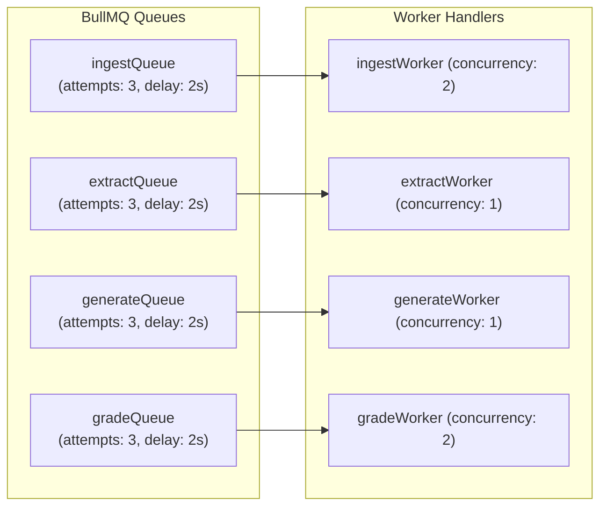

This diagram illustrates the asynchronous task topology partitioned across four specialized BullMQ queues backed by Redis. Each queue pairs with a dedicated worker configured with specific concurrency limits to optimize resource usage and prevent resource exhaustion. Decoupling ingestion, extraction, generation, and grading guarantees that CPU-bound PDF rasterization in `ingestWorker` never starves or degrades interactive question paper generation in `generateWorker`.

- **Job Options**: All queues enforce exponential backoff (`attempts: 3, backoff: { type: "exponential", delay: 2000 }`) and retain the last 200 completed and failed jobs (`removeOnComplete: 200, removeOnFail: 200`).
- **Stage Progression Tracking**: Workers record granular execution timestamps using `startStage()`, `completeStage()`, and `failStage()` in [`job.service.ts`](file:///home/salillakra/quill/backend/src/services/job.service.ts#L37-L71), persisting `durationMs` for every pipeline phase into the `Job.stages` JSON column.

### 14.2 External Service Integrations
- **Google Gemini API**: Accessed via `@google/genai`. Provides multimodal parsing (PDF page images + OCR text), dense text embeddings, grounded RAG token generation, examination paper synthesis, and rubric scoring.
- **Pinecone Serverless**: High-performance vector database hosting 768-dimensional document chunks. Leverages hosted reranking models (`pinecone-rerank-v0`) for precision document retrieval.
- **Cloudflare R2**: Object storage accessed via the S3-compatible `@aws-sdk/client-s3` protocol. Configured with custom endpoint URL and explicit checksum calculation overrides (`requestChecksumCalculation: "WHEN_REQUIRED"`).
- **ClamAV**: Antivirus protection interfacing over local Unix domain sockets or standard TCP ports (default 3310).

---

## 15. Configuration and Environment

Environment variables are validated against the Zod schema in [`backend/src/config/env.ts`](file:///home/salillakra/quill/backend/src/config/env.ts#L3-L31):

| Variable | Description | Required? | Default | Security Notes |
|---|---|:---:|---|---|
| `PORT` | Backend HTTP listen port | Optional | `3001` | Internal container port |
| `NODE_ENV` | Application environment mode | Optional | `development` | Enforces HTTPS cookies in production |
| `DATABASE_URL` | PostgreSQL connection string | **Required** | None | Must contain credentials & schema |
| `REDIS_URL` | Redis connection URL | **Required** | None | Used for BullMQ queues & rate limiting |
| `JWT_SECRET` | Secret key for signing HS256 JWTs | **Required** | None | Minimum 16 characters; rotate in production |
| `JWT_EXPIRES_IN` | Token validity duration | Optional | `7d` | Standard timespan string |
| `FRONTEND_URL` | CORS allowed origin | Optional | `http://localhost:3000`| Restricts browser cross-origin requests |
| `UPLOAD_DIR` | Local disk upload directory | Optional | `./uploads` | Used when R2 credentials are absent |
| `GEMINI_API_KEY` | Google AI Studio API Key | Optional | `""` | **Empty string activates offline Demo Mode** |
| `GEMINI_MODEL` | Generative language model | Optional | `gemini-3.5-flash` | Flash GA model |
| `GEMINI_EMBED_MODEL`| Embedding model identifier | Optional | `gemini-embedding-001`| Automatically replaces sunset models |
| `PINECONE_API_KEY` | Pinecone API access key | **Required** | None | Data plane API access |
| `PINECONE_INDEX` | Target Pinecone index name | Optional | `quill` | Automatically initialized if absent |
| `PINECONE_CLOUD` | Cloud provider for serverless index | Optional | `aws` | Options: `aws`, `gcp`, `azure` |
| `PINECONE_REGION` | Cloud region for serverless index | Optional | `us-east-1` | Matches institutional data residency |
| `METRICS_USERNAME` | Basic Auth user for `/metrics` | Optional | `""` | Required in production |
| `METRICS_PASSWORD` | Basic Auth password for `/metrics`| Optional | `""` | Required in production |
| `CLAMAV_BINARY_PATH`| Path to local `clamscan` binary | Optional | `/usr/bin/clamscan` | Fallback if daemon is absent |
| `CLAMAV_SOCKET` | Path to ClamAV Unix domain socket | Optional | `""` | Recommended for fast scanning |
| `CLAMAV_HOST` | Hostname of ClamAV daemon | Optional | `""` | TCP scanning mode |
| `CLAMAV_PORT` | Port of ClamAV daemon | Optional | `3310` | TCP scanning mode |
| `R2_ACCOUNT_ID` | Cloudflare account identifier | Optional | `""` | Required for R2 storage |
| `R2_ACCESS_KEY_ID` | R2 S3 access key ID | Optional | `""` | Required for R2 storage |
| `R2_SECRET_ACCESS_KEY`| R2 S3 secret access key | Optional | `""` | Required for R2 storage |
| `R2_BUCKET_NAME` | R2 target bucket name | Optional | `quill` | Private bucket identifier |

---

## 16. Build, Run, Test, and Deploy

### 16.1 Local Development Workflow
```bash
# 1. Start Docker infrastructure (PostgreSQL & Redis)
docker compose up -d

# 2. Setup backend
cd backend
cp .env.example .env
bun install
bunx prisma migrate dev
bun run db:seed
cd ..

# 3. Setup frontend
cd frontend
pnpm install
cp .env.example .env.local
cd ..

# 4. Start concurrent development environment
./dev.sh
```

### 16.2 Test Structure and Execution
Quill utilizes Bun's native test runner for backend testing, with 53 unit and integration tests across 6 suites:
```bash
cd backend && bun test
```
- `tests/chunker.test.ts`: Verifies paragraph-boundary chunking, token estimation budgets, and overlap preservation.
- `tests/demo.test.ts`: Validates deterministic feature-hashed bag-of-words vector generation, cosine similarity bounds, and offline mock algorithms.
- `tests/exporters-and-analytics.test.ts`: Verifies DOCX binary buffer synthesis, LaTeX escaping, timetable clash detection algorithms, and single question regeneration.
- `tests/integrate.test.ts`: Checks day normalization and collision deduplication in timetable integration.
- `tests/json-extract.test.ts`: Tests resilient JSON parsing across markdown fences, prose wrapping, and unclosed braces.
- `tests/validators.test.ts`: Validates Zod schemas against valid and edge-case inputs.

### 16.3 CI/CD Pipeline
The GitHub Actions workflow defined in [`.github/workflows/ci.yml`](file:///home/salillakra/quill/.github/workflows/ci.yml) executes on every push and pull request to `main`:

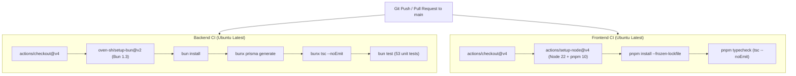

The GitHub Actions continuous integration pipeline enforces rigorous quality gates across both backend and frontend codebases on every push and pull request to the `main` branch. The backend job bootstraps Bun 1.3, compiles Prisma client bindings, runs static type checks (`tsc --noEmit`), and executes all 53 backend unit tests against isolated mock services. Concurrently, the frontend job validates Next.js 16 and React 19 typing through `tsc --noEmit` using pnpm 10 to guarantee zero compilation errors before deployment.

---

## 17. Deployment / Infrastructure Diagram

The following diagram illustrates the deployment topology for production environments based on `backend/Dockerfile`, `docker-compose.yml`, and the application's configuration:

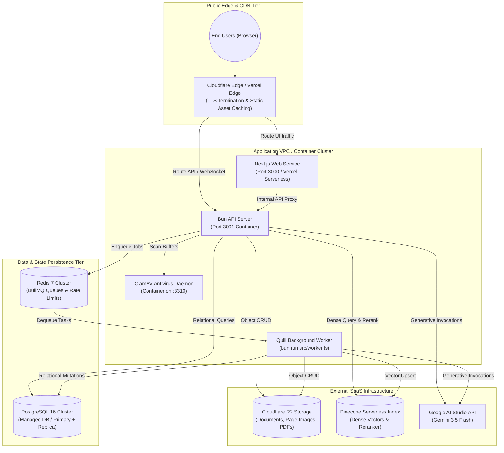

The deployment topology segregates stateless compute nodes from persistent state stores within an isolated virtual private network. Web traffic enters through Cloudflare or Vercel edge networks providing DDoS mitigation, global TLS termination, and static asset caching before reaching the Next.js frontend or Bun API backend. Background processing workers run in decoupled container instances communicating asynchronously with Redis-backed BullMQ queues and managed PostgreSQL, while object data and dense semantic vectors reside securely in Cloudflare R2 and Pinecone Serverless.

---

## 18. Design Decisions and Patterns

### 18.1 Key Design Patterns
1. **Pipeline & Stage Orchestration Pattern**: Background processes are broken into atomic, observable steps (`convert`, `ocr`, `chunk`, `embed`). Stage progression is tracked directly in `Job.stages` with individual start times, completion times, and latencies. This enables partial retries and gives users fine-grained progress feedback.
2. **Provider Seam Pattern**: [`backend/src/config/gemini.ts`](file:///home/salillakra/quill/backend/src/config/gemini.ts) and [`backend/src/lib/demo.ts`](file:///home/salillakra/quill/backend/src/lib/demo.ts) form an abstraction layer over AI capabilities. When `GEMINI_API_KEY` is omitted, the entire platform switches to deterministic offline heuristics without code modifications.
3. **Corrective Validation Loop**: In [`backend/src/utils/gemini-call.ts`](file:///home/salillakra/quill/backend/src/utils/gemini-call.ts#L50-L66), JSON responses from the LLM are validated against Zod schemas. If validation fails, the error summary is sent back to the model in a follow-up prompt, achieving high reliability on complex extractions.
4. **Hybrid Retrieval with Reciprocal Rank Fusion (RRF)**: Combines dense semantic search (Pinecone) with lexical pattern matching (PostgreSQL `ILIKE`) using the RRF formula ($K=60$), followed by a hosted neural reranker to maximize answer accuracy.
5. **Fail-Open Resilience Pattern**: Applied in rate limiting ([`rate-limit.ts`](file:///home/salillakra/quill/backend/src/middleware/rate-limit.ts#L16-L19)) and virus scanning ([`virus-scan.service.ts`](file:///home/salillakra/quill/backend/src/services/virus-scan.service.ts#L69-L72)). If an auxiliary service (Redis or ClamAV) experiences downtime, requests proceed with warnings rather than dropping connections unexpectedly.
6. **Self-Contained Rendering Pattern**: [`backend/src/services/pdf-render.service.ts`](file:///home/salillakra/quill/backend/src/services/pdf-render.service.ts#L26-L46) embeds KaTeX mathematical fonts as base64 data URIs directly into HTML documents before invoking Playwright, eliminating external network dependencies during PDF generation.

---

## 19. Gaps, Risks, and Technical Debt

The following issues are cataloged in descending order of severity:

### Critical & High Severity
1. **Cross-Origin Session Cookie Security**: Next.js (port 3000) and Hono (port 3001) run on separate ports in development. `proxy.ts` checks for the presence of the `quill_session` cookie to guard routes, but cannot verify the cryptographic signature without `jose` verification in Next.js middleware. A unified reverse proxy or Next.js API route rewrite is recommended for production.
2. **Global Master Data Uniqueness**: Unique constraints for `Faculty.email`, `Room.code`, `Course.code`, and `Student [section, rollNo]` are scoped globally rather than per workspace. A second tenant cannot reuse standard room codes like `LH-1` or course codes like `CS201`. Composite unique constraints like `@@unique([workspaceId, code])` should be enforced across all campus models.
3. **In-Process Worker Execution Under Scale**: In the default development setup, BullMQ workers run in the same process as the Hono HTTP server. Long-running OCR and Playwright rendering tasks can block the event loop under heavy load. Workers should be decoupled using `bun run src/worker.ts` in production container clusters.

### Medium Severity
4. **Greedy Schedule Solver vs. Constraint Optimization**: The schedule generator in [`timetable-solver.service.ts`](file:///home/salillakra/quill/backend/src/services/timetable-solver.service.ts) uses a greedy heuristic (assigning the first available day/period). It lacks constraint satisfaction modeling (e.g., OR-Tools CP-SAT) for room capacity limits, lunch breaks, or balanced faculty teaching loads.
5. **Single-Flight OCR Bottleneck**: `ocr.service.ts` serializes OCR processing through a single Tesseract worker to prevent memory corruption. Under high ingestion volume, this creates a processing queue bottleneck. Offloading OCR to a distributed worker pool or cloud vision API would improve throughput.
6. **Non-Incremental OCR**: While vector embeddings are updated incrementally via content hashing, the OCR stage reprocesses all pages on document reingestion. A page-level SHA-256 hash cache would eliminate redundant OCR computation.

---

## 20. Getting Started for New Contributors

### 20.1 Recommended Reading Order
1. **`backend/prisma/schema.prisma`**: Read first to understand the core data models and relationships.
2. **`backend/src/index.ts`**: Understand the server boot sequence, middleware chain, and route bindings.
3. **`backend/src/config/env.ts`**: Review configuration options and environment flags.
4. **`backend/src/workers/ingest.worker.ts`**: Trace the multi-stage ingestion pipeline.
5. **`backend/src/services/rag.service.ts`**: Understand hybrid retrieval, RRF scoring, and SSE streaming.
6. **`frontend/components/app-shell.tsx`**: Review the client-side navigation layout and role guards.

### 20.2 Making Your First Change: Adding a Document Search Endpoint
To walk through the full developer workflow, here is how to add a simple document search endpoint:
1. **Add Validator**: In `backend/src/validators/`, define a search query schema:
   ```typescript
   export const docSearchSchema = z.object({ q: z.string().min(1) });
   ```
2. **Implement Route**: In `backend/src/routes/documents.route.ts`, register the endpoint:
   ```typescript
   documentsRouter.get("/search", async (c) => {
     const user = c.get("user") as SessionUser;
     const q = c.req.query("q") ?? "";
     const matches = await prisma.document.findMany({
       where: {
         title: { contains: q, mode: "insensitive" },
         ...(user.workspaceId ? { workspaceId: user.workspaceId } : { userId: user.id }),
       },
     });
     return c.json(ok(matches));
   });
   ```
3. **Add Unit Test**: In `backend/tests/`, verify query behavior using `bun test`.
4. **Consume in Client**: Add the method to `frontend/lib/api.ts` and bind it to a search input in `frontend/components/app-shell.tsx`.

---

## 21. Glossary

- **Bloom's Taxonomy**: A pedagogical framework classifying cognitive educational objectives into six hierarchical levels: *Remember*, *Understand*, *Apply*, *Analyze*, *Evaluate*, and *Create*.
- **BullMQ**: A Redis-backed NodeJS message queue managing asynchronous task distribution, retries, and parent-child job workflows.
- **Fail-Open**: A resilience pattern where a security or rate-limiting check permits traffic to proceed if its backing service is unavailable, avoiding unexpected outages.
- **Feature Hashing (Hashing Trick)**: An offline algorithmic technique mapping arbitrary text tokens to fixed-size vector indices via hashing functions (e.g., SHA-256), creating bag-of-words embeddings without a neural network.
- **Matryoshka Embeddings**: Dense vector representations structured such that the leading dimensions (e.g., the first 768 of 3072) preserve the majority of semantic information, allowing vector truncation without significant accuracy loss.
- **Pinecone Serverless**: A cloud vector database providing sub-second approximate nearest neighbor (ANN) retrieval over dense embeddings, partitioned by tenant namespaces.
- **Reciprocal Rank Fusion (RRF)**: A rank aggregation algorithm combining search results from multiple independent retrieval models (e.g., dense vector search and lexical keyword matching) by summing reciprocal ranks: $1 / (K + \text{rank})$.
- **Samyak / Today View**: The daily operational schedule dashboard aggregating an educator's teaching slots, extra classes, exam invigilations, and upcoming assignment deadlines.
- **Single-Flight Execution**: A synchronization pattern ensuring that only one resource-intensive task (such as an OCR worker thread) executes at any given time, preventing race conditions and thread pool exhaustion.
